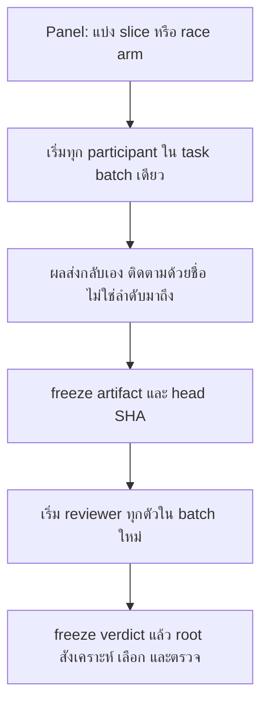
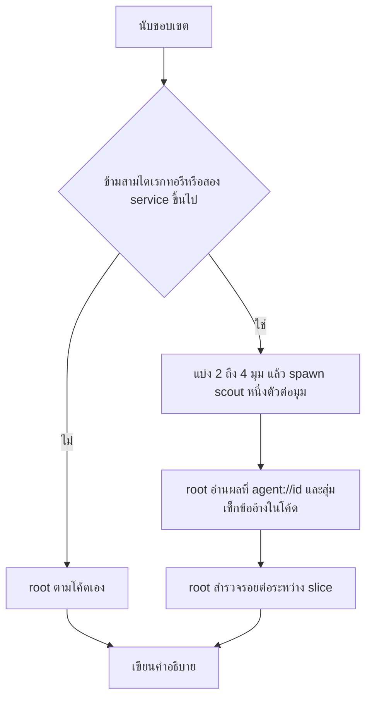
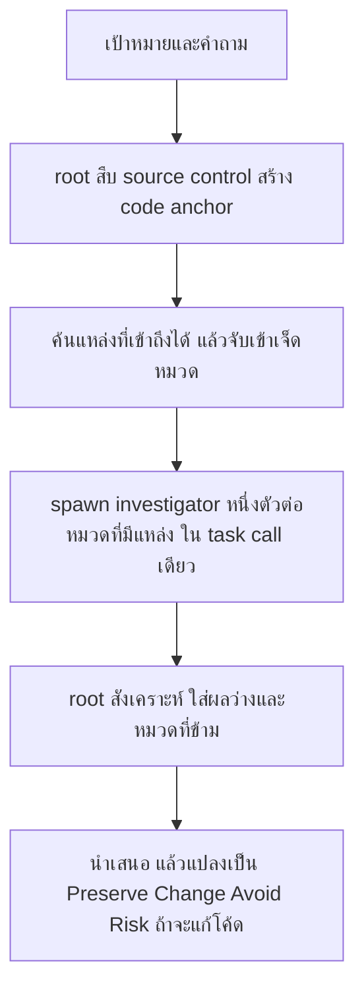
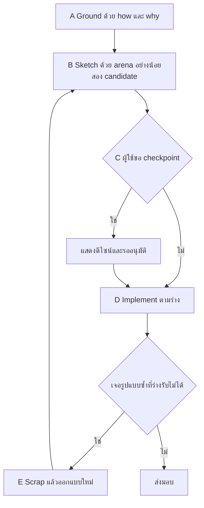
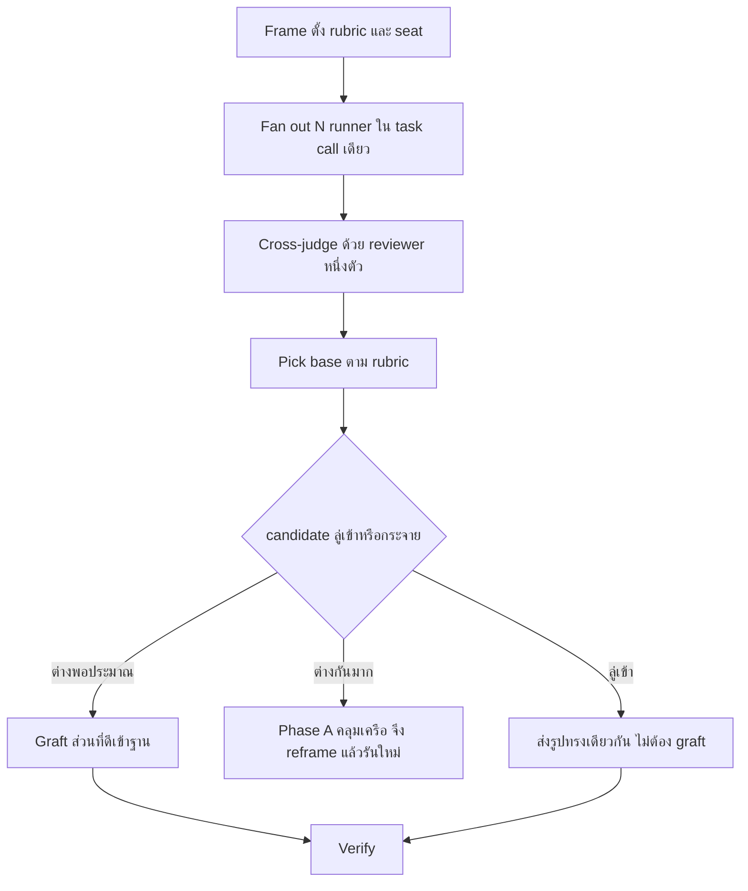
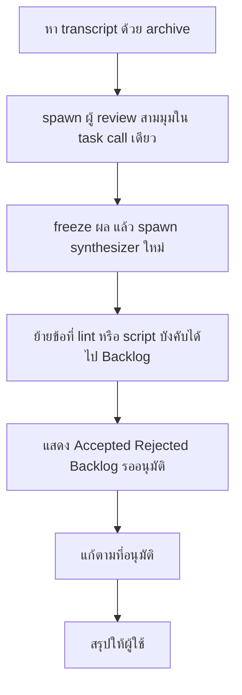
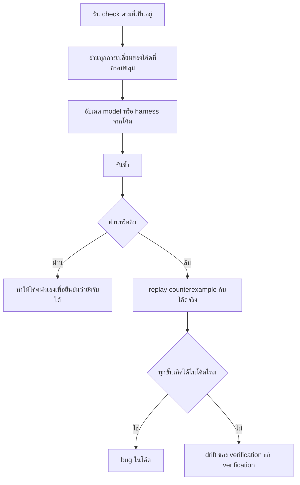

# แคตตาล็อก skill

เอกสารนี้อธิบาย skill ทั้ง 59 ตัวใน `skills/` ของ [pstack-omp-lean](../../README.th.md) แต่ละตัวมีหัวข้อบอกว่าใช้ทำอะไร เรียกอย่างไร
ทำตามลำดับอะไร และ spawn subagent หรือไม่ ส่วน playbook ของ `poteto-mode` อยู่ในเอกสารแยกชื่อ [`playbooks.th.md`](playbooks.th.md)

## skill คืออะไรใน OMP

skill คือโฟลเดอร์ที่มีไฟล์ `SKILL.md` เป็นชุดคำสั่งให้ agent ทำตาม บางตัวมีโฟลเดอร์ `references/` เก็บ template หรือรายละเอียดที่
`SKILL.md` ชี้ไปอ่านต่อ ใน OMP โหลด skill ได้สองทาง

- ผู้ใช้พิมพ์ `/skill:<name>` ตามด้วยงานที่ต้องการ เช่น `/skill:how how does the auth flow work?`
- agent อ่านด้วย URI `skill://<name>` และอ่านไฟล์ข้างในด้วย `skill://<name>/<path>`

ทุก skill ในชุดนี้ตั้ง `disable-model-invocation: true` ยกเว้นสามตัวที่เป็น adapter คือ `pstack-omp`, `orchestrate-omp` และ
`setup-pstack` โมเดลจึงไม่โหลด skill ที่เหลือเอง ต้องให้ผู้ใช้พิมพ์ชื่อ หรือให้ `poteto-mode` เรียกต่อเมื่อขั้นตอนของ playbook ต้องใช้

### เงื่อนไข spawn subagent

repo นี้ให้ chat หลักทำงานเองเป็นค่าเริ่มต้น และ spawn subagent เมื่อผ่าน spawn gate ข้อใดข้อหนึ่งเท่านั้น gate นิยามอยู่ในหัวข้อ
Delegation ของ [`poteto-mode`](../../skills/poteto-mode/SKILL.md) และทุกหัวข้อด้านล่างอ้างเลข gate ตามตารางนี้

| Gate | ชื่อ | เงื่อนไข |
|---|---|---|
| 1 | Context | child อ่านมากกว่าที่ root ต้องใช้ต่อหลังจากนั้น และอ่านแคบลงแล้วก็ยังไม่ลด |
| 2 | Independence | งานต้องการ context สดที่ห้ามเห็น context ของ root เช่น review, verification, judge, design candidate แข่งกัน หรือหน่วยขนานที่เขียนไฟล์ไม่ทับกัน |
| 3 | Conflict | งานต้องการ tool หรือคำสั่งที่ขัดกับของ root และ skill ประสานให้ไม่ได้ |

หัวข้อ "Spawn" ของแต่ละ skill บอกสิ่งที่ `SKILL.md` เขียนไว้จริง ถ้า `SKILL.md` ไม่ระบุเลข gate เอกสารนี้จะบอกว่าไม่ระบุ
และไม่เดาแทน

## สารบัญ

- [Router](#router)
- [OMP adapter](#omp-adapter)
- [ทำความเข้าใจ](#ทำความเข้าใจ)
- [ออกแบบและสำรวจ](#ออกแบบและสำรวจ)
- [ลงมือทำ](#ลงมือทำ)
- [เขียน](#เขียน)
- [Verification](#verification)
- [Review](#review)
- [อื่น ๆ](#อื่น-ๆ)
- [Principles](#principles)
- [ดัชนี skill ทั้ง 59 ตัว](#ดัชนี-skill-ทั้ง-59-ตัว)

| กลุ่ม | Skill |
|---|---|
| Router | `poteto-mode` |
| OMP adapter | `pstack-omp`, `orchestrate-omp`, `setup-pstack` |
| ทำความเข้าใจ | `how`, `why`, `interrogate`, `blast-radius`, `recall`, `ketchup`, `in-your-own-words`, `teach` |
| ออกแบบและสำรวจ | `architect`, `arena`, `swarm`, `figure-it-out`, `sharpen`, `reflect` |
| ลงมือทำ | `tdd`, `correct`, `bro`, `show-me-your-work`, `benchmark-checklist`, `automate-me` |
| เขียน | `unslop`, `technical-writing`, `no-comments` |
| Verification | `create-verification-skill`, `maintain-verification-skill`, `create-formal-verification-skill`, `maintain-formal-verification-skill` |
| Review | `fable-deslop` |
| อื่น ๆ | `typescript-best-practices`, `make-bot-ui`, `poteto-help` |
| Principles | `principle-*` 24 ตัว |

---

## Router

### [`poteto-mode`](../../skills/poteto-mode/SKILL.md)

**ใช้ทำอะไร.** เป็น router ตัวเดียวของชุดนี้ เลือก playbook, ลำดับขั้น, role และ lifecycle protocol ให้งาน แล้วบังคับสไตล์การทำงาน
ของ poteto คือตอบสั้นและละเอียด, ใช้ subagent อย่างจงใจ, เขียนร้อยแก้วที่ไม่มีร่องรอย AI, เขียนโค้ดเรียบง่าย และพิสูจน์ว่างานใช้ได้

**ใช้เมื่อ.** ทุกงานที่ต้องการความเข้มงวด เช่น feature, bug fix, refactoring, perf, investigation หรือเมื่อผู้ใช้ขอให้ทำงาน
ในสไตล์ poteto

**ไม่ใช้เมื่อ.** ผู้ใช้ถามวิธีใช้ pstack ให้ใช้ [`poteto-help`](#poteto-help) แทน เพราะ run ของ pstack กิน token จริง
และ `poteto-help` ตอบโดยไม่เริ่มงาน

**เรียกอย่างไร.** พิมพ์ `/skill:poteto-mode` ตามด้วยเป้าหมายและเช็กที่ผ่านหรือไม่ผ่านได้

```text
/skill:poteto-mode fix this bug report: <วางรายงาน>. Reproduce it first and show me the failing and passing runs.
```

**โครงสร้างของไฟล์.** `SKILL.md` แบ่งเป็นหัวข้อต่อไปนี้

| หัวข้อ | เนื้อหา |
|---|---|
| Non-negotiables | รายการ trigger ที่ชี้ไปยัง skill หรือ playbook เช่น งานไม่ trivial ให้ใช้ `how`, โค้ดที่ข้ามขอบ function ให้ใช้ `architect`, ก่อน commit ให้ใช้ `fable-deslop` เมื่อมี `rpce-cli`, ก่อน review ให้ใช้ `no-comments`, รายงานผลวัดให้ใช้ `benchmark-checklist` และงานยาวที่ผู้ใช้ไปพักให้ใช้ `show-me-your-work` |
| Principles | หลักการ 24 ข้อจัดเป็น Core, Architecture, Verification, Delegation และ Meta แต่ละข้อเป็น skill ชื่อ `principle-<title>` ดูตารางใน[หัวข้อ Principles](#principles) |
| Autonomy | ทำเลยกับงานย้อนกลับได้และการกระทำภายนอก หยุดถามก่อนงานย้อนกลับไม่ได้ เช่น force-push ไป branch ร่วม, deploy, ลบข้อมูล, ส่งข้อความหาลูกค้า และอนุญาตให้ตอบปฏิเสธได้ |
| Delegation | one loop เป็นค่าเริ่มต้น, spawn gate 3 ข้อ, ตารางว่าแต่ละ role รันที่ไหน, lifecycle protocol 4 แบบ, การเรียก `task` และกฎ subagent สด |
| Writing the reply | ประโยคสั้นแบบบอกเล่า, ห้ามขีดยาว, ห้ามใช้ colon เชื่อมประโยค, ทุกข้ออ้างต้องมีหลักฐานหรือป้ายกำกับ |
| Comments | เขียน comment เฉพาะเหตุผลที่โค้ดบอกเองไม่ได้ |
| Bundled scripts | หา path จริงของ `scripts/` ด้วย `realpath skill://poteto-mode` แล้วรัน `bun install` หนึ่งครั้ง |
| Playbooks | รายการ playbook และเงื่อนไขเลือก ดู [`playbooks.th.md`](playbooks.th.md) |

**ขั้นตอน.** เมื่อเรียก skill นี้ agent จับคู่งานกับ playbook เปิด todo list โดยคัดลอกขั้นของ playbook ลงไปตามตัวอักษรก่อน แล้ว
ทำตามทีละขั้น ขั้นที่เลือกไม่ทำต้องคงไว้ในรายการพร้อมบรรทัด `skip: <เหตุผล>` งานใหญ่ข้ามหลายจุดหรือไม่มี playbook ที่ตรงจะส่งไป
[`figure-it-out`](#figure-it-out) ส่วนโปรแกรมยาวหลายวันหลาย PR จะส่งไป playbook Orchestrate

**Spawn.** ไม่ spawn ตอนถูกเรียก chat ที่รับ `/skill:poteto-mode` ทำงานเองทั้งอ่าน วางแผน เขียนโค้ดและ test ตรวจสอบ และสรุป
subagent ต้องผ่าน gate 1, 2 หรือ 3 และ brief ต้องระบุ gate ในบรรทัด ROLE ตาราง role ใน skill ระบุว่า `reviewer` และ `owner`
เป็น child เสมอตาม gate 2 ส่วน `explorer`, `planner`, `designer`, `researcher`, `implementer`, `mechanical`, `synthesizer`
และ `watcher` ทำเองหรือเป็น child เฉพาะกรณีที่ตารางกำหนด ชื่อ role ใหม่ persona หรือ skill ที่ยาว ไม่ถือว่าผ่าน gate

**ผลลัพธ์.** งานตาม playbook ที่เลือก และคำตอบที่เขียนตามหัวข้อ Writing the reply โดยระบุ principle ที่เปลี่ยนการตัดสินใจและ
การเลือกที่ถูกเปลี่ยน

**ไฟล์ reference.** [`playbooks/`](../../skills/poteto-mode/playbooks) เก็บ playbook รายตัว,
[`references/bugbot-triage.md`](../../skills/poteto-mode/references/bugbot-triage.md) ใช้คัดแยก comment ของ Bugbot
ว่าควรแก้ ปัดตก หรือถามต่อ และ `scripts/` เก็บ script ที่ playbook เรียกใช้

---

## OMP adapter

adapter แปลกลไกของ pstack เป็นกลไกของ OMP เท่านั้น ไม่เลือก playbook และไม่เปลี่ยน spawn gate

### [`pstack-omp`](../../skills/pstack-omp/SKILL.md)

**ใช้ทำอะไร.** เป็นสัญญาการทำงานของ pstack บน OMP ว่า role แต่ละตัวใช้ agent ตัวไหน เรียก `task` อย่างไร และ lifecycle protocol
ทำงานอย่างไร ใช้หลัง spawn gate ผ่านแล้วเท่านั้น

**ใช้เมื่อ.** ต้อง spawn subagent ตาม playbook หรือ skill และต้องรู้ชื่อ agent, รูปแบบ brief หรือวิธีรับผล

**ไม่ใช้เมื่อ.** ยังไม่ผ่าน spawn gate skill นี้ไม่ใช่เหตุผลให้ spawn

**เรียกอย่างไร.** ปกติ `poteto-mode` ชี้มาเอง ผู้ใช้ถามได้ว่า role ผูกกับ agent อะไร

```text
/skill:pstack-omp which OMP agent runs the reviewer role, and what goes in a task brief?
```

**เนื้อหาตามลำดับ.**

1. Canonical role map ตาราง role ต่อ agent ได้แก่ `explorer` ใช้ `scout`, `designer` ใช้ `task`, `reviewer` ใช้ `reviewer`,
   `researcher` ใช้ `librarian`, `implementer` และ `owner` ใช้ `poteto-agent`, `mechanical` ใช้ `sonic` และ `watcher` เป็น
   งาน `bash` เบื้องหลัง `planner` กับ `synthesizer` ทำใน root ยกเว้น synthesizer ของ `reflect` ที่รันเป็น `reviewer`
2. Roster ปิด มี agent เก้าตัวคือ `scout`, `reviewer`, `security-reviewer`, `librarian`, `task`, `sonic`, `poteto-agent`,
   `comment-sicko` และ `seance` ค่า `agent` ต้องเป็นชื่อเหล่านี้ และไม่ต้องใส่ `agent` เมื่อใช้ `task` ซึ่งเป็น worker เริ่มต้น
3. Task contract เฉพาะ root เรียก `task` ได้ child ห้ามเรียก `task` ห้ามถามผู้ใช้ และต้องมี `Do not call task or start subagents`
   ใต้ `FORBIDDEN` ในทุก brief item หนึ่งรายการต้องมี `task` กับ `solutionSpace` และมี `name` แบบ CamelCase ไม่เกิน 32 ตัวอักษร
   ห้ามใส่ `model`
4. Brief shape ฟิลด์ที่ต้องมีก่อน dispatch คือ `GOAL`, `ROLE`, `SCOPE`, `CONTEXT`, `ACCEPTANCE`, `VERIFY`, `TIMEBOX`,
   `FORBIDDEN`, `REPORT` และ `STANDING` โดย `ROLE` ต้องระบุ gate ที่ผ่าน
5. Canonical protocols มี Bounded session, Panel, Long-lived owner และ One-shot watcher
6. Ownership และ verification ผู้เขียนห้ามเป็น reviewer ของงานตัวเอง รายงานของ worker ไม่ถือเป็นการยืนยัน commit ใหม่ทำให้
   verdict เดิมเป็นโมฆะ
7. Model routing เลือก agent กับเลือกโมเดลเป็นคนละเรื่อง โมเดลมาจากการตั้งค่าที่ `setup-pstack` เขียน



**Spawn.** ไม่ spawn เอง เป็นเอกสารกลไกที่ใช้หลัง gate ผ่าน

**ผลลัพธ์.** ไม่สร้างไฟล์ เป็นกติกาให้ root เขียน brief และรับรายงานรูปแบบ `PASS | ISSUES | BLOCKED`

**ไฟล์ reference.** ไม่มี

### [`orchestrate-omp`](../../skills/orchestrate-omp/SKILL.md)

**ใช้ทำอะไร.** ประสาน subagent หลายตัวบนงานใหญ่ ให้ root ยังคุยกับผู้ใช้ได้ระหว่างที่งานเดินอยู่เบื้องหลัง

**ใช้เมื่อ.** การสำรวจแบบขนาน การ review โดยผู้เชี่ยวชาญ หรือการ implement ที่แบ่งเจ้าของชัดเจน ช่วยให้ผลเร็วขึ้นหรือแน่นขึ้น

**ไม่ใช้เมื่อ.** งานเล็ก และงานที่ผูกกันแน่นซึ่งควรอยู่ใน session เดียว

**เรียกอย่างไร.**

```text
/skill:orchestrate-omp split the migration into scoped workers and have a reviewer check each branch
```

**ขั้นตอน.**

1. Frame ระบุ done predicate และ artifact สุดท้าย แยกเฉพาะงานอิสระ กำหนดเจ้าของ และเก็บการอนุมัติกับ side effect ภายนอกไว้ที่ root
2. Choose agents ใช้ชื่อตาม inventory ของ `task` ที่เห็นจริง ตารางใน skill ผูกงานกับ agent คือ `scout` สำหรับอ่านโค้ดแคบ ๆ,
   worker เริ่มต้นสำหรับ implement, `sonic` สำหรับงานกลไก, `reviewer` สำหรับคุณภาพโค้ด, `security-reviewer` สำหรับความปลอดภัย
   และ `librarian` สำหรับค้นคว้า library หรือ API ภายนอก
3. Dispatch ใส่ผู้เข้าร่วมอิสระใน batch เดียว ทุก item มี `name`, `task` ครบในตัว และ `solutionSpace` มี `Target`, `Change`,
   `Acceptance` และบอก worker ว่าห้ามเรียก `task`
4. Coordinate ผลส่งกลับเอง อ่านเต็มที่ `agent://<id>` และใช้ `wait` เมื่อ root ไม่มีอะไรทำแล้วเท่านั้น
5. Handoffs รายงานของ worker เป็นช่องทางเดียวที่ข้อมูลไหลขึ้น ใช้สถานะ `PASS`, `ISSUES`, `BLOCKED` และ child ที่หายไปโดยไม่มีรายงานนับเป็นช่องว่าง
6. Integrate รอครบ ตรวจ artifact ที่อ้าง รัน validation ที่ head ที่รวมแล้ว และสรุปหนึ่งชุด

**Spawn.** spawn ตามที่ skill กำหนด คือ `scout`, worker เริ่มต้น, `sonic`, `reviewer`, `security-reviewer` และ `librarian`
ตามตารางงาน `SKILL.md` ไม่ระบุเลข gate ระบุเพียงว่าให้แยกเฉพาะงานอิสระที่มีเจ้าของชัด และให้ข้ามงาน trivial

**ผลลัพธ์.** ผลสรุปหนึ่งชุดพร้อม agent identifier, ข้อค้นพบหรือการเปลี่ยนแปลงที่รับแล้ว, หลักฐาน verification และช่องว่างที่ค้างอยู่

**ไฟล์ reference.** ไม่มี

### [`setup-pstack`](../../skills/setup-pstack/SKILL.md)

**ใช้ทำอะไร.** ตั้งค่าว่า pstack ใช้โมเดลไหนต่อ role และใช้งบ reasoning เท่าไร โดยเขียน `modelRoles` และ
`task.agentModelOverrides` ลง `config.yml` ของ profile ที่ใช้งานอยู่ เหตุผลคือ OMP ไม่เลือกโมเดลต่อการเรียก
`task` โมเดลผูกกับ role และ agent

**ใช้เมื่อ.** ติดตั้งใหม่ ต้องการเปลี่ยนโมเดลหรืองบ reasoning หรืออยากรู้ว่า subagent ใช้โมเดลอะไร

**ไม่ใช้เมื่อ.** ต้องการเปลี่ยนโมเดลของ session หลัก งบของ skill นี้กระทบเฉพาะ agent ที่ถูก spawn ให้ใช้ `/model` หรือ
`modelRoles.default`

**เรียกอย่างไร.**

```text
/skill:setup-pstack
```

**ขั้นตอน.** skill รัน `scripts/apply-models.mjs` และดูแลบทสนทนารอบ ๆ script

1. หา path จริงของ script ด้วย `realpath skill://setup-pstack`
2. แสดงสถานะปัจจุบันด้วย `--show` ค่า `unset` หมายถึง role ใช้โมเดลของ session
3. ถามงบด้วยเครื่องมือ `ask` สี่ตัวเลือกคือ `unlimited`, `large`, `medium` และ `small` งบกำหนดระดับ effort ต่อชั้นของ role
   โดย `tiny` กับ `commit` คงที่ที่ `low` ทุกงบ
4. Preview ด้วย `--budget <label> --dry-run` และอ่านบล็อก `notes:` ให้ผู้ใช้ฟัง
5. ให้ผู้ใช้เปลี่ยน role หรือ agent ผ่าน `--role` และ `--agent` script ปฏิเสธ role ที่ไม่รู้จักและโมเดลที่ไม่อยู่ใน catalog
6. Apply โดยตัด `--dry-run` ออก script รวมค่ากับของเดิมแล้วเขียนด้วย `omp config set`
7. ตรวจ panel ถ้า `reviewer` กับ `security-reviewer` ชี้โมเดลเดียวกัน ให้บอกตรง ๆ ว่า cross-model review กลายเป็น self-review
8. เสนอ `create-verification-skill` หนึ่งครั้ง ถ้าโปรเจกต์ยังไม่มี harness
9. เสนอ `create-formal-verification-skill` หนึ่งครั้ง ถ้ายังไม่มี formal verification skill

**Spawn.** ไม่ spawn

**ผลลัพธ์.** ค่า `modelRoles` และ `task.agentModelOverrides` ใน `config.yml` ของ profile ปัจจุบัน และ path ที่ script พิมพ์

**ไฟล์ reference.** `scripts/apply-models.mjs` พร้อม test ในโฟลเดอร์เดียวกัน ท้าย `SKILL.md` มีตาราง "How roles carry pstack's
work" ที่ผูกงานของ pstack กับ role และ agent

---

## ทำความเข้าใจ

### [`how`](../../skills/how/SKILL.md)

**ใช้ทำอะไร.** อธิบายว่าโค้ดทำงานอย่างไร ในระดับที่วิศวกรอาวุโสที่เพิ่งเข้าทีมใช้สร้าง mental model ได้ ไม่ละเอียดจนเหมือนอ่าน source ทีละบรรทัด

**ใช้เมื่อ.** ถามว่า X ทำงานอย่างไร, ต้องเดินโค้ดก่อนแก้, หรือถามเรื่องตำแหน่งที่โค้ดควรอยู่ เจ้าของ และ layering

**ไม่ใช้เมื่อ.** ถามเหตุผลที่โค้ดมีรูปแบบนั้น ให้ใช้ [`why`](#why)

**เรียกอย่างไร.**

```text
/skill:how how does the request retry flow work in the gateway?
```

**ขั้นตอน.**

1. ประเมินความซับซ้อน ถ้าขอบเขตคลุมเครือให้ระบุการตีความแล้วเริ่มสำรวจ งานง่ายคือโมดูลเดียวหรือ repo เล็กพอจะอ่านไม่กี่ครั้ง root ตามเอง
   งานซับซ้อนคือคำตอบข้ามสามไดเรกทอรีขึ้นไป หรือสอง service ขึ้นไปใน repo ที่ใหญ่เกินอ่านไม่กี่ครั้ง
2. สำรวจ ถ้า repo มี code graph เช่น `graphify query` ให้ถามก่อน แล้วอ่านตาม symbol และช่วงบรรทัด ตามการไหลจาก trigger ไปถึงผล
3. อธิบายตามรูปแบบใน `references/explanation.md` และตัดสินความขัดแย้งระหว่างที่ตัวเองอ่านกับรายงาน explorer ด้วยการเช็กโค้ด



**Spawn.** งานซับซ้อนผ่าน gate 1 `SKILL.md` ระบุเอง ใช้ `scout` หนึ่งตัวต่อมุมใน `task` call เดียว พร้อม
`references/explorer-prompt.md` explorer อ่านอย่างเดียว ห้ามเรียก `task` และห้ามถามผู้ใช้ งานง่ายไม่ spawn

**ผลลัพธ์.** คำอธิบายหัวข้อ Overview, Key Concepts, How It Works, Where Things Live และ Gotchas ตัดหัวข้อที่ไม่เกี่ยวออกได้

**ไฟล์ reference.** [`explanation.md`](../../skills/how/references/explanation.md) นิยามแต่ละหัวข้อและสไตล์การสื่อสาร,
[`explorer-prompt.md`](../../skills/how/references/explorer-prompt.md) เป็น template ของ explorer

### [`why`](../../skills/why/SKILL.md)

**ใช้ทำอะไร.** สืบหาแรงจูงใจและเจตนาเบื้องหลังโค้ด เช่น เหตุผลของ design, regression, postmortem หรือ threshold ที่มีข้อมูลหนุน
แล้วตอบพร้อมการอ้างอิงและระดับความมั่นใจที่แยกชัด

**ใช้เมื่อ.** ถามว่าทำไมโค้ดเป็นแบบนี้ ทำไมเลือก Y หรือตัวเลขนี้มาจากไหน

**ไม่ใช้เมื่อ.** ถามพฤติกรรมตอน runtime ให้ใช้ [`how`](#how)

**เรียกอย่างไร.**

```text
/skill:why why does the quota check run before the upstream call?
```

**ขั้นตอน.**

1. เข้าใจเป้าหมายและคำถาม ถ้าเป้าหมายคลุมเครือให้เดาจากบริบทและบอกการตีความ
2. สืบ source control และสร้าง code anchor ตาม `references/sources/code-archaeology.md` ด้วย `git blame`, `git log --follow -p`
   และ `gh` เพื่อดึง PR กับ ticket ที่เกี่ยวข้อง
3. ค้นหาแหล่งที่เข้าถึงได้ใน session แล้วจับเข้า evidence category เจ็ดหมวด ได้แก่ source control, issue tracker, long-form docs,
   real-time chat, infrastructure observability, error tracking และ product analytics warehouse จากนั้น spawn investigator
   หนึ่งตัวต่อหมวดที่เข้าถึงได้ นอกจาก source control
4. สังเคราะห์เองจากผล step 2 และรายงานทุกฉบับ ตาม `references/synthesis.md` กับ `references/epistemics.md`
5. นำเสนอ โดยรักษาภาษาระดับความมั่นใจให้ตรง



**Spawn.** root ทำ source control และการสังเคราะห์เอง ส่วนหมวดอื่นเป็นแหล่งอิสระที่ข้อมูลดิบมีปริมาณมาก `SKILL.md` ระบุว่าผ่าน gate
1 และ 2 investigator ใช้ `agent: task` และตั้งชื่อ `InvestigatorTickets`, `InvestigatorDocs`, `InvestigatorChat`,
`InvestigatorObservability`, `InvestigatorErrors` และ `InvestigatorWarehouse` แต่ละตัวถือหนึ่งแหล่ง ห้ามเขียนอะไรนอกจากไฟล์ `local://`
ถ้ามีหมวดอื่นเข้าถึงได้หมวดเดียวและหลักฐานมีแค่ไม่กี่ ticket หรือหน้า ให้ root อ่านเอง แหล่งที่เข้าถึงไม่ได้ต้องรายงานว่าใช้ไม่ได้
ห้ามเดาจากความจำ

**ผลลัพธ์.** คำตอบหัวข้อ The Question, The Code in Question, What We Found, What We Can Reasonably Infer, Competing Hypotheses,
What We Don't Know, Sources Consulted และ Confidence Summary Sources Consulted มีหนึ่งบรรทัดต่อหมวด รวมหมวดที่ว่างหรือข้าม

**ไฟล์ reference.** [`epistemics.md`](../../skills/why/references/epistemics.md) กรอบระดับความมั่นใจและวิธีเขียน,
[`investigator-prompt.md`](../../skills/why/references/investigator-prompt.md) template ของ investigator,
[`source-playbook.md`](../../skills/why/references/source-playbook.md) ตัวอย่างสำหรับสร้าง playbook ต่อแหล่ง,
[`synthesis.md`](../../skills/why/references/synthesis.md) รูปแบบคำตอบ และโฟลเดอร์
[`sources/`](../../skills/why/references/sources) ซึ่งมีไฟล์ `code-archaeology.md`, `incident-postmortem.md`, `databricks.md`,
`notion.md`, `linear.md`, `sentry.md`, `slack.md` และ `datadog.md`

### [`interrogate`](../../skills/interrogate/SKILL.md)

**ใช้ทำอะไร.** ให้ reviewer หลายตัวที่ใช้โมเดลต่างกันโจมตีการเปลี่ยนแปลงโค้ดจากมุมอิสระ สัญญาณมาจากความหลากหลายของโมเดล
ไม่ใช่ persona ที่กำหนดให้

**ใช้เมื่อ.** ต้องการ adversarial review, multi-model review, หาจุดบอด หรือการออกแบบที่ยังถกเถียง ก่อน ship

**ไม่ใช้เมื่อ.** ต้องการหาผลกระทบนอก diff ให้ใช้ [`blast-radius`](#blast-radius) และห้ามใช้เพื่อให้ skill แก้โค้ดเอง
เพราะ skill นี้ไม่ auto-apply

**เรียกอย่างไร.**

```text
/skill:interrogate review the diff on this branch against main
```

**ขั้นตอน.**

1. Scope ระบุสิ่งที่จะ review จากไฟล์ที่ผู้ใช้ชี้ หรือ `git diff main...HEAD` ถ้าอยู่บน feature branch ถ้าแพ็กเกจใหญ่ให้เขียนลง
   `local://interrogate-<slug>.md` พร้อม SHA ของ base และ head แล้ว freeze
2. Intent เขียนเจตนาเป็นหนึ่งย่อหน้า ถ้าไม่แน่ใจให้ถามผู้ใช้ด้วย `ask`
3. Spawn Reviewers เริ่มทุก seat ใน `task` call เดียว
4. Synthesize รวมข้อค้นพบ เป็นหนึ่งภาพ ข้อที่ reviewer สองตัวขึ้นไปพบเองเป็นสัญญาณแรงสุด
5. Lead Judgment root เป็น lead reviewer ที่อยู่คนละ session กับ reviewer ทุกตัว จัดทุกข้อค้นพบเป็น Act on, Consider, Noted
   หรือ Dismissed ถ้า root เป็นผู้เขียนโค้ด ข้อ Act on และ Consider ต้องถูกแก้ หรือหักล้างด้วยหลักฐานที่รันได้

**Spawn.** ใช่ ใน task call เดียว ตาราง seat คือ Reviewer A เป็น `reviewer` และ Reviewer B เป็น `task` ที่ brief ห้ามแก้ไฟล์
เพิ่ม seat จาก `security-reviewer` และ `poteto-agent` ได้เมื่อผู้ดูแลตั้ง override ไว้ `SKILL.md` ไม่ระบุเลข gate ตาราง role ใน
`poteto-mode` จัด `reviewer` เป็น child ตาม gate 2 reviewer เป็น leaf ห้ามเรียก `task` skill ให้อ้างว่ารันคนละโมเดลได้ก็ต่อเมื่อ
metadata ที่ OMP ส่งกลับระบุโมเดลที่ resolve แล้วเท่านั้น

**ผลลัพธ์.** รายงานหัวข้อ Intent, Reviewers, Act On, Consider, Noted, Dismissed และ Agreement Map

**ไฟล์ reference.** [`reviewer-prompt.md`](../../skills/interrogate/references/reviewer-prompt.md),
[`rubric.md`](../../skills/interrogate/references/rubric.md),
[`code-quality-review.md`](../../skills/interrogate/references/code-quality-review.md) และ
[`lead-judgment.md`](../../skills/interrogate/references/lead-judgment.md)

### [`blast-radius`](../../skills/blast-radius/SKILL.md)

**ใช้ทำอะไร.** หาว่าการเปลี่ยนแปลงจะทำอะไรพังที่อื่นก่อน ship และพิสูจน์ข้อเท็จจริงข้อเดียวที่ทำให้ปลอดภัยด้วยการรันโค้ดจริง
แทนการเขียนรายงาน เพราะรายงานที่ฟังดูถูกไม่ได้แปลว่าถูก

**ใช้เมื่อ.** ถามว่า blast radius ของ X คืออะไร, สิ่งนี้อาจพังอะไร หรือ review diff เล็กที่ยังไม่ไว้ใจ

**ไม่ใช้เมื่อ.** แค่ต้องการรายชื่อผู้เรียก ซึ่งหาด้วย grep ได้ในไม่กี่วินาที งานของ skill นี้คือความเสียหายที่ grep มองไม่เห็น

**เรียกอย่างไร.**

```text
/skill:blast-radius what could this change to the cache eviction call break?
```

**ขั้นตอน.**

1. อ่านการเปลี่ยนแปลง รวมส่วนที่ diff ไม่ได้เขียนออกมา
2. หาข้อเท็จจริงข้อเดียวที่ทำให้การเปลี่ยนปลอดภัย ใช้เวลาตรงนี้ ไม่ใช่กับรายการความเสี่ยงยาว ๆ
3. มองจุดที่ grep หยุด เช่น source ของ library ที่เรียก, เวอร์ชันที่ pin, ลำดับเวลาการทำงาน, JSON ที่ API คืน, คอลัมน์ DB,
   feature flag และโค้ดที่ไกลออกไปสามช่วง
4. ประเมินแต่ละความเสี่ยงอย่างตรงไปตรงมา มีโอกาสเกิดและต้นทุนจริง อ้าง `file:line` จริง
5. พิสูจน์ข้อเท็จจริงนั้นด้วย script หรือ test ที่รันโค้ดจริง แล้ววางผลที่ได้
6. ถ้าการเปลี่ยนใหญ่หรือกว้าง ให้รัน [`arena`](#arena) เพื่อถามหลายโมเดลคำถามเดียวกัน

skill นี้จัดระดับความมั่นใจของแต่ละข้อเท็จจริงเป็นห้าขั้น ตั้งแต่ "บอกว่าใช่" ซึ่งไม่มีค่า, ชี้บรรทัดจริง, แสดงว่ากรณีเลวเกิดไม่ได้,
รันให้เห็น ไปจนถึงทำซ้ำในแอปที่รันอยู่ และต้องบอกว่าหยุดที่ขั้นไหน

**Spawn.** ไม่ spawn เอง ขั้นที่ 6 เรียก `arena` เมื่อการเปลี่ยนใหญ่หรือกว้าง ซึ่ง `arena` เป็นตัว spawn

**ผลลัพธ์.** รายงานหัวข้อ What it does, The one fact it's safe because of (พิสูจน์แล้วหรือระบุว่า unproven), Risks, Cleared
และ Before you merge เขียนผ่าน [`unslop`](#unslop)

**ไฟล์ reference.** ไม่มี

### [`recall`](../../skills/recall/SKILL.md)

**ใช้ทำอะไร.** สร้างบริบทงานล่าสุดของผู้ใช้กลับมาจากประวัติ session, สถานะปัจจุบัน และบันทึกร่วม (รายงานจากผู้ใช้, fix ที่เคยออก,
incident) แล้วส่งสรุปสั้นของสถานะตอนนี้

**ใช้เมื่อ.** "recall งานของฉันเรื่อง X", "catch me up", "ฉันเคยทำอะไรไว้" ก่อนเริ่มหรือกลับมาทำงานต่อ

**ไม่ใช้เมื่อ.** ต้องกลับไปทำต่อจาก session เดียวที่ระบุชัด ให้ใช้ playbook Session pickup และถ้าผู้ใช้ให้ capsule สถานะครบแล้ว
ให้ใช้ capsule นั้นและข้ามการขุด

**เรียกอย่างไร.**

```text
/skill:recall my work on the usage ledger from last week
```

**ขั้นตอน.**

1. แยกประเภทแล้วเลือกเส้นทาง
2. ล็อกขอบเขตก่อนค้น กำหนดช่วงเวลา (ค่าเริ่มต้นเจ็ดวันล่าสุด), หัวข้อ และโปรเจกต์ปัจจุบัน ห้ามส่ง `project: "*"`
3. แตกงานข้ามประวัติ session ด้วย `scout` ขนาน แต่ละตัวรับ slice ของ corpus และคืนผลตามสคีมาเดียวกัน ถ้ามีหนึ่งหรือสอง session ให้ข้ามการแตกงาน
4. กวาดบันทึกร่วมเมื่อหัวข้อระบุ feature, ไฟล์ หรือบั๊ก ค้น source control เองตามขั้นที่ 2 ของ `why` และส่งแหล่งอื่นให้ investigator
   ของ `why` ข้ามได้เฉพาะ recall กิจกรรมล้วนที่ไม่มีเป้าหมาย
5. ตรวจกับสถานะจริงด้วย `git` และ `gh`
6. เขียนสรุปตามสัญญาผลลัพธ์

**Spawn.** ใช่ ขั้นที่ 3 spawn `scout` ขนานเพื่อให้ transcript ดิบอยู่ใน subagent และส่งแค่ข้อค้นพบกลับมา ขั้นที่ 4 ใช้ investigator
ของ `why` `SKILL.md` ไม่ระบุเลข gate และให้เลือก agent ตาม role ที่ทำ ตามหัวข้อ Delegation ของ `poteto-mode`

**ผลลัพธ์.** สรุปเรียงตาม Capsule (ไม่เกิน 5 ข้อ), Threads (หนึ่งบรรทัดต่อเรื่อง พร้อมป้ายสถานะเช่น `[merged #N]`,
`[open PR #N]`, `[in flight <branch>]`, `[reverted #N]`), Problems (ไม่เกิน 5 ข้อ) และ Next move

**ไฟล์ reference.** ไม่มี อ้าง `skill://why/references/sources/code-archaeology.md`

### [`ketchup`](../../skills/ketchup/SKILL.md)

**ใช้ทำอะไร.** เล่าให้ผู้ใช้ตามทันว่าใน chat นี้มีอะไรเปลี่ยนตั้งแต่ข้อความล่าสุดของเขา ด้วยคำง่ายและภาพเล็ก ๆ แล้วลิสต์ทุกเรื่องที่รอ
เขาตัดสินใจ พร้อมข้อมูลพอให้ตัดสินจากคำตอบเดียว

**ใช้เมื่อ.** ผู้ใช้กลับมาที่ chat หลังไปทำอย่างอื่น

**ไม่ใช้เมื่อ.** ต้องการรื้อบริบทข้าม session ให้ใช้ [`recall`](#recall)

**เรียกอย่างไร.**

```text
/skill:ketchup
```

**ขั้นตอน.**

1. รวบรวมสิ่งที่เปลี่ยน turn นี้อ่านอย่างเดียว ไม่แก้โค้ด ไม่เริ่มแอปหรืองาน และไม่โพสต์อะไร เก็บงานของตัวเอง รายงานจาก subagent
   และข้อความของคนอื่นใน chat แล้วเช็กสถานะปัจจุบันของ PR, CI และ agent ที่ chat แตะ
2. แยก action item คือการตัดสินใจหรือขั้นที่มีแต่ผู้ใช้ทำได้ ห้ามแต่งขึ้นมาเติมคำตอบ
3. เขียนคำตอบ เปิดด้วยประโยคเดียวที่บอกว่ามีอะไรรอผู้ใช้ ส่วนเล่าเรื่องไม่เกิน 100 คำ ภาพก่อน แล้วสรุปหนึ่งบรรทัดต่อเรื่องที่ผู้ใช้ขอ
   แล้วจึงลิสต์ action item แต่ละข้อมีการตัดสินใจ ตัวเลือกของ agent ผลต่อผู้ใช้ หลักฐาน และความเสี่ยง ห้ามตัดข้อเพื่อให้ครบจำนวนคำ

skill ใช้น้ำเสียงของ [`bro`](#bro) คือคำง่าย ประโยคสั้น ไม่ใช้ศัพท์เทคนิค ภาพที่ใช้ได้คือ screenshot, วิดีโอ, แผนภาพ Mermaid,
กราฟจากตัวเลขจริง ตารางไม่นับเป็นภาพ แต่ละภาพไม่เกินหกกล่อง

**Spawn.** ไม่ spawn

**ผลลัพธ์.** ข้อความตอบเดียว ไม่สร้างไฟล์

**ไฟล์ reference.** ไม่มี

### [`in-your-own-words`](../../skills/in-your-own-words/SKILL.md)

**ใช้ทำอะไร.** ให้ agent เล่าซ้ำด้วยคำของตัวเองว่าเข้าใจเป้าหมายและปัญหาของผู้ใช้อย่างไร

**ใช้เมื่อ.** อยากเช็กว่า agent เข้าใจคำขอที่ยาวหรือยุ่งก่อนเริ่มทำ

**ไม่ใช้เมื่อ.** `SKILL.md` ไม่ระบุ

**เรียกอย่างไร.**

```text
/skill:in-your-own-words <วางคำขอที่ยาวหรือยุ่ง>
```

**ขั้นตอน.** มีขั้นเดียว restate ด้วยคำของตัวเองว่าเป้าหมายและปัญหาของผู้ใช้คืออะไร

**Spawn.** ไม่ spawn

**ผลลัพธ์.** ข้อความ restate

**ไฟล์ reference.** ไม่มี

### [`teach`](../../skills/teach/SKILL.md)

**ใช้ทำอะไร.** อธิบายงานชิ้นหนึ่งให้คนเข้าใจจริง ทั้งว่ามันคืออะไร ทำงานอย่างไร และทำไมถึงเป็นแบบนั้น ในคำอธิบายเดียวตามจังหวะของผู้ใช้
เป้าหมายคือความเข้าใจ ไม่ใช่การเปลี่ยนโค้ด

**ใช้เมื่อ.** "teach me this", "ช่วยให้ฉันเข้าใจ X จริง ๆ", "อธิบาย change หรือ subsystem นี้ให้ฟัง"

**ไม่ใช้เมื่อ.** เป้าหมายคือเปลี่ยนโค้ด skill นี้ระบุว่าเป้าหมายคือความเข้าใจ ไม่ใช่การแก้อะไร

**เรียกอย่างไร.**

```text
/skill:teach explain how the retry and fallback logic fits together
```

**ขั้นตอน.**

1. เลือกว่าผู้ใช้ควรเข้าใจอะไรสองสามข้อ จากเหตุที่เขาถาม และสิ่งที่เขารู้อยู่แล้วซึ่งอ่านจากบทสนทนา ไม่ใช่ถามเขา
2. ให้ [`how`](#how) และ [`why`](#why) ทำการขุด ไม่ทำซ้ำ รันทั้งคู่ขนานแล้วรวมผล ขนาดตามคำถาม และคง `why` ให้แคบเป็นค่าเริ่มต้น
   รักษาภาษาระดับความมั่นใจของ `why` ไว้
3. เริ่มด้วยคำนิยามธรรมดา แล้วผูกกับกรณีตรงหน้า และอธิบายกลไกที่ทำให้เข้าใจ
4. คุยแบบสนทนา ไม่เป็นการบรรยายหรือการแสดง ไม่มี quiz และไม่ป้ายว่าส่วนไหนสำคัญหรือยาก
5. แสดงด้วยของจริงและวาดทีละส่วน ถ้ามีส่วนเคลื่อนไหวสามส่วนขึ้นไป ให้วาดเป็นชุดภาพที่เพิ่มทีละชิ้น ไม่วาดภาพเดียวรวมทุกอย่าง

เขียนผ่าน [`unslop`](#unslop) ด้วยภาษาพูดธรรมดา

**Spawn.** ไม่ spawn เอง เรียก `how` และ `why` ซึ่งขุดเอง และอาจ spawn ตามเงื่อนไขของแต่ละ skill

**ผลลัพธ์.** คำอธิบายนั้นเอง ไม่ใช่รายงานว่าทำอะไรไป เริ่มด้วยประเด็นหลัก ตามด้วยบัญชีธรรมดาว่ามันคืออะไร ทำงานอย่างไร ทำไม
และเรื่องที่ตามต่อได้ด้วย `how` หรือ `why`

**ไฟล์ reference.** ไม่มี

---

## ออกแบบและสำรวจ

### [`architect`](../../skills/architect/SKILL.md)

**ใช้ทำอะไร.** ร่างชนิดข้อมูล, signature และโครงสร้างโมดูลก่อนเขียนโค้ด โดยให้ body เป็น `not implemented` กับ pseudocode
แล้วอยู่ใน loop ต่อเพื่อเติมโค้ดตามร่างที่เลือก

**ใช้เมื่อ.** งานไม่ trivial ที่การกระโดดไปเขียนโค้ดจะล็อกรูปทรงผิด หรือโค้ดที่ข้ามขอบ function

**ไม่ใช้เมื่อ.** งานกลไกที่รูปทรงชัดอยู่แล้ว การรัน arena ซ้ำบนดีไซน์ที่ลงตัวแล้วเป็นการออกแบบเกินจำเป็น

**เรียกอย่างไร.** ผู้ใช้ขอ checkpoint ได้ด้วยการใส่ `with checkpoint`

```text
/skill:architect design the retry policy module for the gateway
```

**ขั้นตอน.** เปิด todo list หนึ่งรายการต่อ phase

1. Phase A Ground รัน [`how`](#how) บน subsystem ที่เกี่ยว และรัน [`why`](#why) ถ้าดีไซน์เปลี่ยนความเป็นเจ้าของหรือ layering ข้ามได้เฉพาะงาน greenfield จริง
2. Phase B Sketch รัน [`arena`](#arena) ด้วยงานร่างดีไซน์ ส่ง `references/runner-prompt.md` เป็น prompt ของ runner ต้องได้ candidate
   อย่างน้อยสองรูปทรงที่ต่างโครงสร้าง คัดทุก candidate กับ `references/design-red-flags.md` และเทียบความลึกของ interface
3. Phase C Agree ค่าเริ่มต้นคือไปต่อได้เลย ไม่มี checkpoint ผู้ใช้เลือกให้หยุดขออนุมัติได้ ถ้าต้องการแรงกดดันแบบ adversarial ให้รัน [`interrogate`](#interrogate) บนร่าง
4. Phase D Implement เติมโค้ดตามร่าง ร่างคือสัญญา การเบี่ยงเบนเป็นสัญญาณให้แจ้ง ไม่ใช่แรงเสียดทานให้กลืน
5. Phase E Scrap ถ้ามีแรงเสียดทานเป็นรูปแบบซ้ำที่ร่างรับไม่ได้ ให้ทิ้งร่าง ย้อนไปรัน `how`, ออกแบบใหม่โดยถือข้อจำกัดใหม่เป็นสมมติฐานวันแรก,
   ลบก่อนเพิ่ม แล้วกลับ Phase B



**Spawn.** ใช่ ผ่านขั้น Phase B ซึ่งรัน `arena` `SKILL.md` ระบุว่า candidate ดีไซน์แข่งกันคือ gate 2 และต้องผ่านเสมอ ร่างสองชุดที่ root
เขียนเองไม่ใช้แทน เพราะใช้ context กับสัญชาตญาณแรกเดียวกัน seat เริ่มต้นคือ `task` กับ `reviewer` เพิ่ม `poteto-agent` เป็น seat ที่สามเมื่อมีตัวเลือกจริงเกินสอง
Phase D รันใน root

**ผลลัพธ์.** ร่างชนิดข้อมูลและ signature (ไฟล์เดียวสำหรับงานเล็ก หรือ module map กับ type definition สำหรับงานใหญ่) เขียน usage ของผู้เรียกก่อนแล้วจึงสร้างร่างจาก usage นั้น
มี rationale ตาม `references/rationale-template.md` รวมหัวข้อ Synthesis decision

**ไฟล์ reference.** [`runner-prompt.md`](../../skills/architect/references/runner-prompt.md),
[`sketch-discipline.md`](../../skills/architect/references/sketch-discipline.md),
[`design-red-flags.md`](../../skills/architect/references/design-red-flags.md) และ
[`rationale-template.md`](../../skills/architect/references/rationale-template.md)

### [`arena`](../../skills/arena/SKILL.md)

**ใช้ทำอะไร.** ให้ผู้ลงแข่ง N ตัวทำงานเดียวกัน เลือกตัวที่เป็นฐาน แล้วต่อกิ่งส่วนที่ดีที่สุดของตัวที่แพ้เข้าไป

**ใช้เมื่อ.** ความพยายามครั้งเดียวกับ artifact ที่ไม่ trivial จะล็อกรูปทรงผิด และต้องการ design หรือ code bakeoff

**ไม่ใช้เมื่อ.** ต้องการแบ่งงานเป็น slice หรือแข่งเอาผลแรกที่ผ่าน ให้ใช้ [`swarm`](#swarm) ถ้า candidate ลู่เข้ารูปทรงเดียวกัน
ก็ส่งรูปทรงนั้นได้เลยโดยไม่ต้องต่อกิ่ง

**เรียกอย่างไร.**

```text
/skill:arena three candidates for the invoice export format, graded on how easy each is to extend
```

**ขั้นตอน.** เปิด todo list หนึ่งรายการต่อ phase

1. Frame ระบุ artifact ที่แต่ละ candidate ผลิต สร้าง rubric 3 ถึง 6 ข้อที่ให้คะแนนได้ (candidate เห็นแต่โจทย์ ไม่เห็น rubric) เลือก seat และกำหนด
   ที่เขียนผลแยกกันของแต่ละ candidate ด้วย git worktree หรือ `/tmp/arena-<slug>/candidate-<n>/`
2. Fan out เริ่มผู้ลงแข่งทุกตัวใน `task` call เดียว ถ้ามีตัวที่ไม่คืนผล ให้ไปต่อด้วย N-1 และจดการหลุด
3. Cross-judge หลัง candidate ครบ เริ่ม `reviewer` หนึ่งตัวเป็นผู้ตัดสินอ่านอย่างเดียว คนละ session กับผู้ลงแข่ง freeze candidate ก่อน
4. Pick a base อ่านทุก candidate จนจบ ให้คะแนนตาม rubric ทีละข้อ เทียบกับผู้ตัดสิน และเลือกฐานที่ผู้ดูแลในอนาคตต่อยอดง่ายที่สุด
5. Graft เดินดูตัวที่แพ้เพื่อหาของที่ควรย้าย มักตัวละหนึ่งถึงสองอย่าง และรวมด้วยมือให้อยู่ใน mental model เดียว
6. Verify ตรวจ artifact ที่สังเคราะห์ตามหลัก [`principle-prove-it-works`](#principles)



**Spawn.** ใช่ ผู้ลงแข่ง N ตัวและ judge หนึ่งตัวใน `task` call แยกกัน seat เริ่มต้นคือ `task` กับ `reviewer` และ `poteto-agent` เป็น seat ที่สามที่ต่างออกไป
ผู้เรียกอย่าง `architect` ตั้ง seat เองได้ ใช้ agent เดียวกันหลายครั้งได้เมื่องานเป็นแบบ generation-bound `SKILL.md` ของ `arena` ไม่ระบุเลข gate
`architect` ระบุว่า candidate ดีไซน์ที่แข่งกันคือ gate 2 ผู้ลงแข่งเป็น leaf และ N บวก judge ต้องไม่เกิน `task.maxConcurrency`

**ผลลัพธ์.** artifact ที่สังเคราะห์แล้วหนึ่งชิ้น พร้อมบันทึกสั้นที่ระบุฐานและเหตุผล คำตัดสินของ judge ส่วนที่ต่อกิ่งและต้นทาง สิ่งที่ปัดตก ผล verification
และโมเดลที่ resolve แล้วของผู้ลงแข่งและ judge เมื่อคุณค่าของ arena มาจากความหลากหลายของโมเดล

**ไฟล์ reference.** ไม่มี

### [`swarm`](../../skills/swarm/SKILL.md)

**ใช้ทำอะไร.** แตก worker ขนาน N ตัว รอให้ครบ แล้วคืนรายงานเดียว ใช้กับงานครอบคลุมขนาน การแข่ง (race) gauntlet และการสำรวจ

**ใช้เมื่อ.** แต่ละ slice หรือ arm ต้องการ context สดของตัวเอง เช่น coverage อิสระ การแข่ง หรือ blackbox verification

**ไม่ใช้เมื่อ.** coverage ที่ script ทำได้ใน loop เดียว ไม่ใช่ swarm

**เรียกอย่างไร.**

```text
/skill:swarm check each of these five endpoints against the spec in its own slice and report one table
```

**ขั้นตอน.** เปิด todo list หนึ่งรายการต่อ phase

1. Frame ระบุ done predicate และรายงานที่ต้องคืน ยืนยันว่าผ่าน spawn gate เลือกรูปทรง (แบ่ง slice, race หรือผสม) ถ้าเป็น race ต้องประกาศ `first pass`,
   `rank all` หรือ `best-of` ก่อน spawn กำหนด N ตามจำนวน slice ที่ต้องการจริง เลือก agent และให้ worker ที่เขียนไฟล์มีที่เขียนของตัวเอง
2. Fan out เริ่ม worker ทุกตัวใน `task` call เดียว brief ครบในตัว รายงานใช้ `PASS`, `ISSUES` หรือ `BLOCKED` พร้อมหลักฐาน
3. Aggregate อ่านผลสุดท้าย ทิ้งผลที่ไม่บันทึก SHA และวิธีวัดตามที่ brief กำหนด แล้ว respawn ครั้งเดียวด้วยชื่อใหม่ ถ้าพลาดอีกให้บันทึกเป็นช่องว่าง
   ซึ่งไม่นับเป็น pass
4. Report คืนรายงานเดียวใน chat มีตาราง บรรทัดสรุปปัญหา ช่องว่าง และกฎของ race

**Spawn.** ใช่ `SKILL.md` ระบุให้ยืนยันก่อนว่าการแตกงานผ่าน spawn gate โดยแต่ละ slice หรือ arm ต้องการ context สดและคุ้มค่า token worker เริ่มต้นคือ
`task` ใช้ `scout` กับ slice ที่อ่านอย่างเดียว และ `sonic` กับ slice กลไกที่ระบุครบ worker เป็น leaf

**ผลลัพธ์.** รายงานรวมใน chat

**ไฟล์ reference.** ไม่มี

### [`figure-it-out`](../../skills/figure-it-out/SKILL.md)

**ใช้ทำอะไร.** ออกแบบ playbook ที่ตรวจสอบย้อนหลังได้เมื่อไม่มี playbook ที่แคบกว่าตรงกับงาน ปรับความเข้มงวดตามงาน วนด้วยสมมติฐาน
และบันทึกการตัดสินใจ สิ่งที่ส่งก่อนมีโค้ดคือตัว workflow เอง

**ใช้เมื่อ.** migration ขนาดใหญ่ งานหลายส่วนที่ทะเยอทะยาน หรืองานที่มนุษย์จะมา review หลังไปพัก

**ไม่ใช้เมื่อ.** มี playbook ที่ตรงอยู่แล้ว และโปรแกรมยาวหลายวันหลาย PR ซึ่ง `poteto-mode` ส่งไป playbook Orchestrate

**เรียกอย่างไร.**

```text
/skill:figure-it-out migrate every route handler to the new error type, I'll review it tomorrow
```

**ขั้นตอน.** todo แรกคืออ่านหัวข้อ Principles ของ `poteto-mode`

1. Phase A Frame ต้องระบุได้ก่อนเริ่มว่า done คืออะไรในรูป predicate ที่พิสูจน์ผิดได้, ขอบเขตเชิงปริมาณ และระดับความเข้มงวดซึ่งเอนไปทางสูง
2. Phase B Design the workflow แยกเป็นหน่วยเล็กที่ลงได้เอง เรียงความไม่รู้ที่เสี่ยงที่สุดก่อน สร้าง harness สำหรับ verification ก่อนงาน
   และจับ baseline จากสถานะก่อนเปลี่ยน ใช้ [`architect`](#architect) สำหรับการตัดสินใจ one-way door ตัดสินว่าอะไรแตกงาน โดยค่าเริ่มต้นคือไม่มี
   แล้วลงรายการ phase ที่ออกแบบ
3. Phase C Run the loop แต่ละหน่วยคือการทดลอง ตั้งสมมติฐาน เปลี่ยนให้น้อยที่สุด วัดกับ predicate บน artifact จริง เก็บถ้าดีขึ้น ย้อนถ้าไม่
   verdict คือ VERIFIED, NOT VERIFIED หรือ INCONCLUSIVE และ INCONCLUSIVE ไม่ใช่ pass
4. Phase D Keep the audit trail บันทึกด้วย [`show-me-your-work`](#show-me-your-work) และมักจะ commit trail
5. Phase E Verify and hand back ตรวจทั้งหมดกับ predicate ของ Phase A บนผลิตภัณฑ์จริง และเข้ารหัสการแก้ที่เกิดซ้ำเป็น gate

**Spawn.** โดยค่าเริ่มต้นไม่ spawn หน่วยจะแตกงานได้ก็ต่อเมื่อผ่าน spawn gate ของ `poteto-mode` และเลือก agent ตาม role ที่ทำ ใช้ `architect`
ซึ่งรัน `arena` ได้เฉพาะ one-way door

**ผลลัพธ์.** playbook ที่ออกแบบ, ระดับความเข้มงวดและเหตุผล, path ของ decision trail, สิ่งที่ยืนยันกับ predicate แล้ว และสิ่งที่ยังเปิดอยู่

**ไฟล์ reference.** ไม่มี

### [`sharpen`](../../skills/sharpen/SKILL.md)

**ใช้ทำอะไร.** ลับงานก่อนเริ่ม ว่าผู้เชี่ยวชาญระดับสูงจะทำอย่างไร ผู้ใช้ต้องการอะไรจริง ๆ และข้อกำหนดละเอียดพอดีหรือไม่

**ใช้เมื่อ.** อยากยกระดับงานก่อนเริ่มให้เป็นมืออาชีพมากขึ้น เน้นผลลัพธ์ และไม่ระบุเกินจำเป็น

**ไม่ใช้เมื่อ.** `SKILL.md` ไม่ระบุ

**เรียกอย่างไร.**

```text
/skill:sharpen write a script that finds duplicate invoices in the ledger export
```

**ขั้นตอน.** `SKILL.md` เป็นย่อหน้าเดียว ก่อนเริ่มให้ถามว่าผู้เชี่ยวชาญจะทำอย่างไร (แหล่งดิบ วิธีจริง และการตรวจจากภายนอกว่าผลถูก)
ผู้ใช้ต้องการอะไรจริง และงานระบุเกินหรือขาด ผ่อนข้อจำกัดที่ไม่รับใช้เป้าหมายเท่าที่เพิ่มข้อที่รับใช้ ปล่อยการเลือกที่เป็นของผู้ใช้ไว้เปิด
เติมเฉพาะสิ่งที่ทำให้งานดีขึ้น ไม่ใช่ใหญ่ขึ้น คงการตรวจจากภายนอกหนึ่งอย่างเสมอ ไม่เล่ากรอบความคิดออกมา แล้วทำงาน

**Spawn.** ไม่ spawn

**ผลลัพธ์.** ตัวงานเอง ไม่มีรายงานกรอบความคิด

**ไฟล์ reference.** ไม่มี

### [`reflect`](../../skills/reflect/SKILL.md)

**ใช้ทำอะไร.** ขุดบทเรียนที่คงทนจากบทสนทนาปัจจุบัน แล้วส่งแต่ละข้อไปเป็นการแก้ skill ที่มีอยู่ด้วยผู้ review สามมุมกับ synthesizer

**ใช้เมื่อ.** ผู้ใช้พูดว่า reflect หลังจบงานที่มีบทเรียน

**ไม่ใช้เมื่อ.** บทสนทนาเล็กน้อย นอกเรื่อง หรือมี skill คลุมอยู่แล้วและ agent ทำตามถูก เรื่องที่เกิดครั้งเดียวไม่ใช่บทเรียน

**เรียกอย่างไร.**

```text
/skill:reflect
```

**ขั้นตอน.**

1. หา transcript ของบทสนทนานี้ผ่านออบเจ็กต์ `archive` ในเครื่องมือ `eval` ขอบเขตคือโปรเจกต์ปัจจุบัน ห้ามส่ง `"*"` ถ้าหาไม่เจอให้ส่ง digest แทน
2. Spawn ผู้ review สามตัวใน `task` call เดียว แต่ละมุมใช้ template ใน `references/`
3. Synthesize รอครบสามตัวแล้ว freeze ผล spawn synthesizer เป็น session ใหม่ที่ไม่ใช่ session ของผู้ review ตัวใดตัวหนึ่ง คืนรายการ Accepted, Rejected และ Backlog
4. ตรวจการบังคับเชิงโครงสร้าง ข้อ Accepted ที่ lint, script, metadata flag หรือ runtime check บังคับได้แน่นกว่า ให้ย้ายไป Backlog
5. Apply แสดงผลทั้งหมดและรออนุมัติอย่างชัดแจ้งก่อนแก้ข้อ Accepted ห้าม auto-apply ส่วน Backlog ลง tracker ได้เลย การแก้เล็กน้อยทำตรง
   การแก้ใหญ่ทำตาม playbook authoring-a-skill
6. สรุปให้ผู้ใช้เป็นรายการสั้น



| มุม | Agent | Template |
|---|---|---|
| Judgment | `reviewer` | [`judgment-reviewer.md`](../../skills/reflect/references/judgment-reviewer.md) |
| Tooling | `task` | [`tooling-reviewer.md`](../../skills/reflect/references/tooling-reviewer.md) |
| Divergent | `security-reviewer` | [`divergent-reviewer.md`](../../skills/reflect/references/divergent-reviewer.md) |

**Spawn.** ใช่ ผู้ review สามตัวตามตารางข้างต้น และ synthesizer เป็น `reviewer` ใน session ใหม่ ทุกตัวเป็น leaf และ brief ห้ามแก้ไฟล์ `SKILL.md` ไม่ระบุเลข gate
`poteto-mode` ระบุว่า synthesizer ของ `reflect` ตัดสิน conversation ของ root เอง จึงเป็น child ตาม gate 2 ถ้าผู้ review รายงานว่า MCP ที่ต้องใช้ขาดจาก session
ให้รันมุมนั้นใหม่เป็น `task`

**ผลลัพธ์.** รายการ Accepted, Rejected และ Backlog แล้วการแก้ skill ที่ผู้ใช้อนุมัติ และสรุปสุดท้ายหัวข้อ Edits applied, New skills created,
Backlog filed และ Dropped

**ไฟล์ reference.** [`judgment-reviewer.md`](../../skills/reflect/references/judgment-reviewer.md),
[`tooling-reviewer.md`](../../skills/reflect/references/tooling-reviewer.md),
[`divergent-reviewer.md`](../../skills/reflect/references/divergent-reviewer.md) และ
[`synthesizer.md`](../../skills/reflect/references/synthesizer.md)

---

## ลงมือทำ

### [`tdd`](../../skills/tdd/SKILL.md)

**ใช้ทำอะไร.** แก้บั๊กโดยทำให้พฤติกรรมที่พังรันได้ก่อนแตะโค้ด production ได้ regression test ที่ล้มก่อนแก้และผ่านหลังแก้

**ใช้เมื่อ.** ผู้ใช้ขอ TDD, failing test หรือ regression test หรือบั๊กมีเป้า test ในเครื่องที่ชัดและถูก

**ไม่ใช้เมื่อ.** ทางเขียน test ไม่ชัด, แพง, ต้องใช้ integration หนัก หรือไม่มีใครขอ ถ้าต้องตั้ง harness กว้าง, mock เปราะ, state เฉพาะ production, วิธี reproduce
คลุมเครือ หรือ fixture เปลี่ยนมาก ให้ข้าม test ใหม่และใช้การตรวจที่ใกล้ที่สุดแทน ดีกว่าไม่มี test ใหม่เมื่อทางเลือกคือ test ที่ไม่ดี

**เรียกอย่างไร.**

```text
/skill:tdd the invoice total rounds the wrong way for negative amounts, write the failing test first
```

**ขั้นตอน.**

1. เข้าใจบั๊ก พฤติกรรมที่ตั้งใจ พฤติกรรมปัจจุบัน และ reproduction ที่เล็กที่สุด
2. เลือกการตรวจที่รันได้แคบที่สุด ใช้ test ที่ใกล้ที่สุดซึ่งโค้ดส่วนนั้นใช้อยู่ ไม่สร้างทางใหม่จากศูนย์เพื่อให้ครบขั้น
3. เขียน test ที่ล้มก่อน ให้เล็กที่สุดและเข้ารหัสพฤติกรรมที่ตั้งใจ ไม่ใช่สะท้อนการ implement
4. รัน test ใหม่ก่อนแก้ และยืนยันว่าล้มด้วยเหตุที่ตั้งใจ
5. แก้บั๊กด้วยการเปลี่ยน production ที่เล็กที่สุด
6. รัน regression test ซ้ำ

**Spawn.** ไม่ spawn

**ผลลัพธ์.** การแก้พร้อมรายงานหลักฐาน ชื่อ test หรือการตรวจที่ล้มก่อนแก้และความล้มที่เกิด ชื่อการรันที่ผ่านหลังแก้ และ validation ใกล้เคียงที่ทำ
ถ้าแสดงหลักฐานก่อนแก้ไม่ได้ ต้องบอกเหตุผลและการตรวจที่ใช้แทน

**ไฟล์ reference.** ไม่มี

### [`correct`](../../skills/correct/SKILL.md)

**ใช้ทำอะไร.** หาความผิดพลาดที่ agent ทำซ้ำใน repo แล้วทำให้แต่ละอย่างเกิดไม่ได้ด้วยการลองสถาปัตยกรรมก่อน แล้วชนิดข้อมูล แล้ว lint ที่ error บอกวิธีแก้
แล้ว test และเขียนเอกสารเป็นขั้นสุดท้าย

**ใช้เมื่อ.** ผู้ดูแลแก้ agent ด้วยความผิดเดิมซ้ำ ทำทุกครั้งที่ผู้ดูแลแก้ agent

**ไม่ใช้เมื่อ.** ความผิดพลาดเกิดแค่ครั้งเดียว กลุ่มความผิดพลาดนับเมื่อเกิดซ้ำสองครั้ง

**เรียกอย่างไร.**

```text
/skill:correct
```

**ขั้นตอน.**

1. หากลุ่มความผิดพลาด อ่าน commit ล่าสุด, revert, comment ใน review, ไฟล์คำสั่งของ agent และ comment ที่อธิบาย workaround แล้วจัดกลุ่ม
2. แก้แต่ละกลุ่มที่ระดับสูงสุดที่ใช้ได้ เรียงเป็น (1) กำจัดด้วยสถาปัตยกรรม ให้แต่ละ state มีเจ้าของเดียวและแต่ละงานมีทางเดียว
   (2) บังคับด้วย type ถ้ายัง compile ผ่านให้เพิ่ม lint หรือ CI check ที่ error ระบุไฟล์ type หรือ function ที่ต้องใช้แทน (3) test พฤติกรรม
   (4) เขียนเอกสารหรือกฎให้ agent เป็นขั้นสุดท้ายและเฉพาะเรื่องที่ต้องใช้วิจารณญาณ
3. แก้และพิสูจน์ แก้กลุ่มที่เกิดบ่อยที่สุดทีละ commit พิสูจน์ว่า check ใหม่ล้มกับความผิดพลาดจริงในอดีต รันคำสั่งเดียวกันในเครื่องและใน CI
4. เก็บตารางกฎ ในไฟล์คำสั่งของ agent จับคู่แต่ละกฎกับสิ่งที่บังคับ ถ้ากฎมีอยู่แล้วแต่ไม่มีอะไรบังคับ นับเป็นการเกิดซ้ำและต้องแก้ที่ระดับสูงสุดในการเปลี่ยนเดียวกัน

**Spawn.** ไม่ spawn

**ผลลัพธ์.** commit ต่อกลุ่ม ตารางกฎในไฟล์คำสั่ง และคำตอบที่ระบุแต่ละกลุ่มพร้อมหลักฐาน ระดับที่เลือก และเหตุผลที่ระดับสูงกว่าใช้ไม่ได้

**ไฟล์ reference.** ไม่มี

### [`bro`](../../skills/bro/SKILL.md)

**ใช้ทำอะไร.** เล่าข้อความล่าสุดของ agent ใหม่เป็นภาษามนุษย์ธรรมดา ไม่มีศัพท์เทคนิค

**ใช้เมื่อ.** อ่านคำตอบล่าสุดไม่รู้เรื่อง

**ไม่ใช้เมื่อ.** `SKILL.md` ไม่ระบุ ถ้าต้องการสรุปสิ่งที่เปลี่ยนใน chat ทั้งช่วง ให้ดู [`ketchup`](#ketchup) ซึ่งยืมน้ำเสียงของ skill นี้

**เรียกอย่างไร.**

```text
/skill:bro
```

**ขั้นตอน.** มีขั้นเดียว เล่าข้อความล่าสุดใหม่ให้ง่ายและสั้นลง เหมือนคนหนึ่งคุยกับอีกคน

**Spawn.** ไม่ spawn

**ผลลัพธ์.** ข้อความที่เล่าใหม่

**ไฟล์ reference.** ไม่มี

### [`show-me-your-work`](../../skills/show-me-your-work/SKILL.md)

**ใช้ทำอะไร.** เก็บ decision trail ที่ตรวจทานได้สำหรับงานยาวหรืองานที่ไม่มีคนเฝ้า เป็นไฟล์ TSV หนึ่งแถวต่อการตัดสินใจ

**ใช้เมื่อ.** งานอัตโนมัติ งานหลาย phase หรืองานที่มนุษย์จะ review หลังไปพัก

**ไม่ใช้เมื่อ.** งานสั้นที่การตัดสินใจเห็นชัดอยู่แล้ว skill นี้ระบุให้ข้ามเรื่องเล็กและเรื่องที่เห็นชัดในตัว

**เรียกอย่างไร.**

```text
/skill:show-me-your-work keep a decision log for this migration run
```

**ขั้นตอน.**

1. เริ่มจาก header ใน `references/decision-log-template.tsv` คอลัมน์คือ `ts`, `phase`, `decision`, `why`, `evidence` และ `result`
   หลักฐานเป็นตัวชี้ ไม่ใช่ย่อหน้า
2. บันทึกแถวด้วย `scripts/log.sh` ซึ่งใส่ `ts` เขียน header ครั้งแรก ล้างแท็บและขึ้นบรรทัดใหม่ และกันเซลล์ที่ขึ้นต้นด้วย `=`, `+`, `-` หรือ `@`
   ต้องหา path จริงด้วย `realpath skill://show-me-your-work` ก่อนรัน บันทึกที่จุดตัดสินใจและ checkpoint ไม่ใช่ทุกการกระทำ
3. เก็บไว้ในเครื่องเป็นค่าเริ่มต้น (`decisions.tsv` หรือ `.audit/<task-slug>.tsv`) และ commit เฉพาะเมื่อผู้ review ต้องใช้ trail เพื่อเชื่อผล
4. ก่อนส่งมอบ ตรวจ log กับ transcript เป็นการ append อย่างเดียว ไม่แก้หรือลบแถวเดิม แถวที่ผิดแก้ด้วยแถวใหม่ที่แทนที่
5. ให้ `reviewer` ตรวจ trail ข้ามตระกูลโมเดล และปิดคำตอบด้วยหัวข้อ "Attention" ที่ขึ้นต้นด้วยบรรทัด `reviewed by <model>`

**Spawn.** ใช่ ตอนท้ายสุด spawn `reviewer` หนึ่งตัวบนโมเดลคนละตระกูลกับที่ทำงาน เพื่ออ่าน audit trail กับ transcript แล้วชี้สิ่งที่ผู้ใช้ควรสังเกต
`SKILL.md` ไม่ระบุเลข gate และบอกให้เลือก agent ตาม role ที่ทำตามหัวข้อ Delegation ของ `poteto-mode` ต้องตรวจว่า `reviewer` ชี้ไปโมเดลตระกูลอื่นจริง
และบอกในส่วน Attention เมื่อไม่ใช่

**ผลลัพธ์.** ไฟล์ log แบบ TSV และหัวข้อ Attention ท้ายคำตอบ

**ไฟล์ reference.** [`decision-log-template.tsv`](../../skills/show-me-your-work/references/decision-log-template.tsv) และ
[`scripts/log.sh`](../../skills/show-me-your-work/scripts/log.sh)

### [`benchmark-checklist`](../../skills/benchmark-checklist/SKILL.md)

**ใช้ทำอะไร.** ตรวจการวัดประสิทธิภาพก่อนรายงานหรือลงมือตามตัวเลขนั้น ให้ครบทั้งตัวจำกัด การจูน ขีดจำกัด error การทำซ้ำ ความเกี่ยวข้อง และงานที่เกิดขึ้นจริงหรือไม่

**ใช้เมื่อ.** รัน benchmark หรือรายงาน speedup หรือ regression ที่วัดมาเอง

**ไม่ใช้เมื่อ.** ผู้ใช้ขอค่าประมาณคร่าว ๆ รันครั้งเดียวพอ แต่ยังต้องเช็กข้อ 4 กับข้อ 7 และบอกว่าเป็นการรันเดียว การเลือกระหว่างตัวเลือกไม่นับเป็นค่าประมาณ

**เรียกอย่างไร.**

```text
/skill:benchmark-checklist vet the 30 percent faster export number before I put it in the PR
```

**ขั้นตอน.**

1. ก่อนรัน เขียนข้ออ้างที่คาดว่าจะรายงาน อ่าน script วัดว่านับอะไรและมองข้ามอะไร และเช็ก `uptime` กับ `nproc`
2. ตอบเจ็ดคำถามด้วยหลักฐานจากการรัน ได้แก่ ทำไมไม่เร็วเป็นสองเท่า (ตัวจำกัดคืออะไร), จูนแล้วหรือยัง, ทะลุขีดจำกัดหรือเปล่า, error หรือไม่, ทำซ้ำได้ไหม,
   สำคัญจริงหรือเปล่า และงานเกิดขึ้นจริงหรือไม่
3. รายงาน เริ่มด้วย verdict คือเร็วขึ้น ช้าลง ไม่มีความต่างที่วัดได้ หรือสรุปไม่ได้ ให้ตัวเลขพร้อมหน่วย จำนวนรัน ช่วง และตัวจำกัด
   ถ้าอ้างความต่างแต่บอกตัวจำกัดไม่ได้ หรือด้านใดไม่ได้จูน ให้เรียกว่าสรุปไม่ได้

**Spawn.** ไม่ spawn

**ผลลัพธ์.** verdict พร้อมตัวเลข จำนวนรัน ช่วง และตัวจำกัด body ของ PR ใส่ตัวเลขหลักตัวเดียว ส่วนหลักฐานอยู่ใน artifact ที่ลิงก์ skill นี้ยังตรวจ baseline ของ
playbook Perf issue และ harness ของ Hillclimb

**ไฟล์ reference.** ไม่มี

### [`automate-me`](../../skills/automate-me/SKILL.md)

**ใช้ทำอะไร.** นำวิธีทำงานของผู้ใช้มาเขียนเป็น skill แบบ `-mode` ส่วนตัวที่ agent จะทำตาม เช่น `jay-mode` ด้วยการร้อยกัน การขุดประวัติ
playbook authoring-a-skill และ [`unslop`](#unslop)

**ใช้เมื่อ.** "automate me", สร้างหรืออัปเดต mode skill ของฉัน, จับ preference หรือสไตล์ของฉันลง skill

**ไม่ใช้เมื่อ.** ต้องการ skill เฉพาะงานให้ใช้ playbook authoring-a-skill อย่างเดียว ไม่ต้องขุดประวัติ และ workflow แคบเรื่องเดียวเป็น skill ธรรมดา ไม่ใช่ mode skill

**เรียกอย่างไร.**

```text
/skill:automate-me update my mode skill with what changed in the last two weeks
```

**ขั้นตอน.**

0. ตรวจว่ามี skill เดิมไหม ค้น `.omp/skills/*-mode/SKILL.md` จากไดเรกทอรีทำงานขึ้นไปถึงรากของ repo และ `~/.omp/agent/skills/*-mode/SKILL.md` ถ้ามีให้ยืนยันเจตนา
   (อัปเดตเป็นค่าเริ่มต้น หรือเริ่มใหม่) โหมดอัปเดตขุดเฉพาะประวัติหลังแก้ skill ล่าสุด
1. ขุดประวัติ ขอบเขตเป็นโปรเจกต์ปัจจุบัน ห้ามส่ง `project: "*"` แตกเป็น `scout` ขนานหลาย slice ของประวัติ สัญญาณที่ซ้ำใน 2 slice ขึ้นไปจึงเชื่อถือ
2. ถามผู้ใช้ตรง ๆ ด้วย `ask` หนึ่งถึงสองคำถาม ตัวเลือก 4 ถึง 6 ข้อ แล้วถามเปิดหนึ่งข้อ ห้ามถามเป็นสิบ
3. จัดกลุ่มข้อค้นพบเป็นหัวข้อ เช่น Response style, Autonomy, Subagents, Review and verify, Process ใช้เฉพาะที่เกี่ยว
4. ร่าง skill ตาม playbook และ `omp://skills.md` วางที่ `.omp/skills/<handle>-mode/SKILL.md` หรือ `~/.omp/agent/skills/<handle>-mode/SKILL.md`
   ตั้ง `disable-model-invocation: true` เป็นค่าเริ่มต้น
5. ปรับร้อยแก้วด้วย [`unslop`](#unslop) แสดงร่างและรับ feedback หลายรอบ
6. ลงใน worktree แยกจาก main commit และเปิด PR ไม่ push เข้า main ตรง ๆ

**Spawn.** ใช่ ขั้นที่ 1 spawn `scout` ขนานเพื่อขุดแต่ละ slice ของประวัติ `SKILL.md` ไม่ระบุเลข gate และบอกให้เลือก agent ตาม role ที่ทำตามหัวข้อ Delegation ของ `poteto-mode`

**ผลลัพธ์.** skill แบบ `<handle>-mode` หนึ่งตัวใน PR

**ไฟล์ reference.** ไม่มี อ้าง playbook `authoring-a-skill.md` และ `omp://skills.md`

---

## เขียน

### [`unslop`](../../skills/unslop/SKILL.md)

**ใช้ทำอะไร.** ลบร่องรอยของ AI ออกจากงานเขียนทุกชนิด ตรวจหารูปแบบที่ระบุแล้วเขียนใหม่ โดยรักษาความหมายและโทนที่ตั้งใจ

**ใช้เมื่อ.** เขียนหรือรีวิวร้อยแก้วทุกแบบ รวมถึงคำตอบถึงผู้ใช้ `poteto-mode` และ skill อื่นเรียก skill นี้

**ไม่ใช้เมื่อ.** ต้องการมาตรฐานเอกสารที่เป็นชั้น ให้ใช้ [`technical-writing`](#technical-writing) ซึ่งเรียก `unslop` ต่ออีกชั้น

**เรียกอย่างไร.**

```text
/skill:unslop rewrite this PR description
```

**ขั้นตอน.** สแกนหารูปแบบแล้วเขียนใหม่ เลขข้อเป็น id ที่ skill อื่นอ้าง ข้อที่ถูกลบจะทิ้งช่องว่างไว้ จึงมีเลขข้ามไป หมวดที่มี ได้แก่

| หมวด | เลขข้อ | ตัวอย่างสิ่งที่จับ |
|---|---|---|
| Content | 3, 5 | วลี `-ing` ลอย ๆ, การอ้างแหล่งที่คลุมเครือ |
| Language | 7 ถึง 12 | ศัพท์แบบ AI, "serves as" แทน "is", "not just X but Y", กฎสาม, การวนคำพ้อง |
| Style | 13 ถึง 19 | ขีดยาว, colon เป็นตัวเชื่อม, ตัวหนาเกิน, หัวข้อ title case, emoji, เครื่องหมายคำพูดโค้ง |
| Communication artifacts | 20, 22 | วลีแบบ chatbot, น้ำเสียงประจบ |
| Filler | 23 ถึง 25 | "in order to", การ hedge เกิน, บทสรุปกว้าง ๆ |
| Jargon | 26 | คำนามอุปมานามธรรม เช่น substrate, wedge, vector |
| Plain speech | 27 ถึง 33 | พูดว่ามันทำอะไรไม่ใช่รู้สึกอย่างไร, ประโยคหนาแน่น, active voice, ตัด adverb, ใช้คำธรรมดา, ภาษาแต่งเกิน, การบีบอัดเกิน |

**Spawn.** ไม่ spawn

**ผลลัพธ์.** ข้อความที่เขียนใหม่

**ไฟล์ reference.** ไม่มี

### [`technical-writing`](../../skills/technical-writing/SKILL.md)

**ใช้ทำอะไร.** มาตรฐานการเขียนทางเทคนิคแบบชั้น ได้แก่โครงสร้างแบบ Diátaxis, ประโยคแบบ Google developer style, กฎคำสั่งแบบ STE และ syntax แบบ Global English
เขียนให้วิศวกรที่เหนื่อยเข้าใจตั้งแต่อ่านครั้งแรก

**ใช้เมื่อ.** เขียนหรือรีวิวเอกสาร RFC readme คำอธิบาย PR หรือข้อความ commit

**ไม่ใช้เมื่อ.** ข้อความ UI ของผลิตภัณฑ์ ใช้แนวทาง copy ของผลิตภัณฑ์แทน

**เรียกอย่างไร.**

```text
/skill:technical-writing write the README section for the new retry config
```

**ขั้นตอน.** ใช้ครบสี่ชั้น โดยมีสามกฎอยู่เหนือชั้น คือตัดทุกคำที่ไม่ทำงาน ใช้คำสั้นธรรมดา และเมื่อกฎทำให้ประโยคแย่ลงให้แก้ด้วยทางอื่นหรือปล่อยไว้

1. เลือกโหมดก่อน หนึ่งเอกสารหนึ่งโหมด ตามแกนว่าเนื้อหานำไปสู่การลงมือหรือความเข้าใจ และรับใช้การเรียนรู้หรือการทำงาน
   ได้เป็น tutorial, how-to, reference หรือ explanation ห้ามผสมโหมด
2. เขียนประโยคถึงผู้อ่านตาม Google developer style เช่น พูดกับ "you" ในกาลปัจจุบัน ระบุผู้กระทำ เขียนคำสั่งเป็น imperative และวางเงื่อนไขไว้ก่อนคำสั่ง
3. ให้ข้อความโหลดทีละข้อตามกฎ STE เช่น หนึ่งคำสั่งต่อประโยค แยกประโยคที่ยาวเกิน และคงคำว่า "the" กับ "a"
4. ไม่ให้ประโยคเปิดสองความหมายตาม Global English เช่น วาง "only" ชิดคำที่มันขยาย แตกสายคำนามที่ยาว และไม่ใช้ slash
5. แปรจังหวะประโยค มีมุมมองที่โหมดอนุญาต และเจาะจงแทนที่จะเป็นกลางจนจืด

ส่วน "Voice and repo specifics" ระบุให้ใช้ [`unslop`](#unslop) กับทุกเอกสาร คำอธิบาย PR คือบรีฟที่ผู้ review อ่านได้ใน 1 นาที ไม่วาง swarm log
รายการ SHA หรือตารางตัวเลข ให้ลิงก์แทน

**Spawn.** ไม่ spawn

**ผลลัพธ์.** เอกสารที่เขียนตามมาตรฐาน ข้อเสนอคำใหม่ที่ควรเพิ่มในกฎคำนามอุปมาของ `unslop` ให้ส่งมาในคำตอบพร้อม diff ห้ามแก้ `unslop` เอง

**ไฟล์ reference.** ไม่มี

### [`no-comments`](../../skills/no-comments/SKILL.md)

**ใช้ทำอะไร.** spawn Comment Sicko เพื่อตรวจ comment แก้ข้อค้นพบที่ยอมรับ และเสนอการเข้ารหัสข้อจำกัดที่ comment อ้าง

**ใช้เมื่อ.** ก่อน review โค้ด `poteto-mode` ระบุให้รันก่อน review

**ไม่ใช้เมื่อ.** `SKILL.md` ไม่ระบุ ขอบเขตคือไฟล์หรือ diff ที่ผู้เรียกให้ ถ้าไม่มีก็ใช้ diff ปัจจุบันเทียบ base branch (ค่าเริ่มต้น `main`) รวม working tree

**เรียกอย่างไร.**

```text
/skill:no-comments
```

**ขั้นตอน.**

1. spawn `task` ด้วย `agent: "comment-sicko"` และส่งขอบเขต ไม่ต้องย้ำกฎของมัน
2. ตรวจรายงานและ diff ปฏิเสธการแก้โค้ดแอปพลิเคชัน การหลุดขอบเขต การลบที่ได้รับข้อยกเว้น และเหตุผล `MUST KILL` ที่ระบุผิด ตรวจ suppression ของ lint และ
   TypeScript ที่หลุดไป ก่อนยอมรับ kill หรือ keep ที่บางของ `IMPORTANT` หรือ `do not remove` ให้รัน [`how`](#how) หรือ [`why`](#why) บน symbol นั้น
   รายงานที่ถูกปฏิเสธให้ revert แล้วรันซ้ำหนึ่งครั้ง ถ้าถูกปฏิเสธอีกให้รายงานว่าเปิดอยู่และให้ `/skill:no-comments` ล้มเหลว
3. แก้ข้อที่ยอมรับและเล็กโดยตรง เช่น ลบ dead path ตัด parameter หรือใช้ API จริง ถ้าการแก้ต้องมีรูปทรงให้รัน [`architect`](#architect) หนึ่งครั้งและหยุดที่ร่าง
4. implement การแก้ที่ราก root cause ที่เล็กที่สุดในขอบเขต ลบ workaround ทุกตัวที่ระบุ ถ้า root cause อยู่นอกขอบเขตให้แก้ส่วนในขอบเขตที่เล็กที่สุดและรายงานส่วนที่เหลือเป็นเปิด
5. comment ข้อจำกัดที่ว่า `do not remove`, `do not change wording` หรือ `talk to X before changing` ให้เก็บข้อที่เป็นเรื่องที่เราเปลี่ยนไม่ได้ และเสนอ type,
   runtime check, test หรือ CI lint ที่ถูกที่สุดในขอบเขต รออนุมัติแบบ interactive ถ้าอนุมัติให้เข้ารหัสแล้วลบ มิฉะนั้นลบและรายงานข้อจำกัดว่าเปิดอยู่
6. รายงานจำนวนที่ลบ comment ที่คืน การรันซ้ำ ร่าง architect การแก้ ข้อเสนอเข้ารหัส ข้อจำกัดที่ไม่ถูกบังคับ และงานเปิดอื่น

**Spawn.** ใช่ หนึ่งตัวคือ `comment-sicko` ผ่าน `task` `SKILL.md` ไม่ระบุเลข gate ระบุเพียงให้ยอมตามมุมมองสดของ Comment Sicko และเลือก agent ตาม role
ที่ทำตามหัวข้อ Delegation ของ `poteto-mode` ขั้นอื่นอาจเรียก `how`, `why` หรือ `architect`

**ผลลัพธ์.** โค้ดที่ลบหรือแก้ comment แล้ว และรายงานตามข้อ 6

**ไฟล์ reference.** ไม่มี

---

## Verification

สี่ skill นี้เป็นสองคู่ สร้างและดูแล verification ปกติที่ขับแอปจริง และสร้างและดูแล formal verification ที่ตรวจทุกกรณีในขอบเขตที่กำหนด

### [`create-verification-skill`](../../skills/create-verification-skill/SKILL.md)

**ใช้ทำอะไร.** สร้าง skill ใน repo ชื่อ `verify-<app>` ที่ขับแอปแบบเดียวกับผู้ใช้ รับได้ทุกภาษา framework และแพลตฟอร์ม เพื่อให้ agent ถัดไปพิสูจน์พฤติกรรมได้
skill ที่สร้างเขียนให้ agent อ่านแบบเย็น ไม่เคยเห็นแอปมาก่อน

**ใช้เมื่อ.** "make a control skill for this repo" หรือโปรเจกต์ไม่มีวิธีที่เป็น script ในการพิสูจน์พฤติกรรม UI, CLI หรือ service

**ไม่ใช้เมื่อ.** มี `verify-*` skill อยู่แล้ว ให้ดูแลด้วย [`maintain-verification-skill`](#maintain-verification-skill)

**เรียกอย่างไร.**

```text
/skill:create-verification-skill
```

**ขั้นตอน.**

1. สัมภาษณ์ repo ไม่ใช่ผู้ใช้ หาจาก codebase ว่า surface คืออะไร, รันอย่างไร, ขับอย่างไร (harness ที่มีอยู่ก่อน แล้วจึงเลือก `browser` ใน `eval`,
   `bash` กับ `pty`, `curl` หรือเครื่องมือ native), สังเกตหลักฐานอะไรได้, และรันสองตัวคู่กันได้ไหม ถามผู้ใช้เฉพาะสิ่งที่สังเกตไม่ได้
2. สร้าง `.omp/skills/verify-<app>/SKILL.md` มีหัวข้อ Launch, Doctor, Drive, Evidence, Cleanup และ Helpers ทุกหัวข้อมาจากสิ่งที่พบจริง ไม่เหลือ placeholder
3. หว่าน feature map ที่ `features/README.md` กับหนึ่งไฟล์ต่อ feature ที่ผู้ใช้เห็น (เริ่ม 3 ถึง 5 ตัว) ตามรูปแบบในตัวอย่าง แต่ละไฟล์มี H2 สี่หัวข้อ
   คือ `Sub-features`, `How to get to it (user POV)`, `Driving it with <harness>` และ `Gotchas`
4. พิสูจน์ skill ที่สร้างก่อนส่งมอบ รันตามคำสั่งของมันตั้งแต่ต้นจนจบหนึ่งครั้ง (launch, doctor, ขับ feature หนึ่งตัว, เก็บหลักฐาน, cleanup)
   แล้วยืนยันว่าหลักฐานยังอยู่หลัง cleanup skill ที่ไม่เคยถูกรันเป็นแค่ร่าง
5. เสนอวงจรดูแลด้วย `/skill:maintain-verification-skill`

**Spawn.** ไม่ spawn

**ผลลัพธ์.** โฟลเดอร์ `.omp/skills/verify-<app>/` ที่มี `SKILL.md`, `features/README.md` และไฟล์ feature พร้อมหลักฐานว่ารันได้จริง

**ไฟล์ reference.** [`feature-map-example/`](../../skills/create-verification-skill/references/feature-map-example) มี
[`README.md`](../../skills/create-verification-skill/references/feature-map-example/README.md),
[`create-note.md`](../../skills/create-verification-skill/references/feature-map-example/create-note.md) และ
[`search.md`](../../skills/create-verification-skill/references/feature-map-example/search.md)

### [`maintain-verification-skill`](../../skills/maintain-verification-skill/SKILL.md)

**ใช้ทำอะไร.** ตรวจเป็นรอบเพื่อให้ verification skill และ feature map ยังตรงกับแอป ผู้อ่าน source ขนานต่อ feature, session สดเดียวที่ขับทุก feature
และอย่างมากหนึ่ง PR ของการแก้ที่พิสูจน์แล้ว

**ใช้เมื่อ.** "audit the verify skill" หรือแอปเปลี่ยนจน feature map อาจเก่า

**ไม่ใช้เมื่อ.** ยังไม่มี verification skill ให้หยุดและชี้ไป `/skill:create-verification-skill` ห้ามแก้โค้ดผลิตภัณฑ์ระหว่างรอบ

**เรียกอย่างไร.**

```text
/skill:maintain-verification-skill
```

**ขั้นตอน.** ผลมีสามแบบ `clean` (ไม่ต้องมี branch หรือ PR), `changed` (หนึ่ง PR ของการแก้ที่พิสูจน์แล้ว) และ `blocked`

0. หาเป้าหมาย ถ้ามีหลาย candidate ให้ถามด้วย `ask`
1. ทำความสะอาด index ของ feature map
2. Source wave ใช้ `scout` อ่านอย่างเดียวหนึ่งตัวต่อไฟล์ feature พร้อมกัน แต่ละตัวอธิบายว่า feature ทำงานอย่างไรจาก source ชี้ doc drift และคืนสูตร live-verification หนึ่งสูตร
3. Reconcile รวมสูตรที่ซ้ำ สุ่มเช็ก drift และกวาดหาพื้นผิวที่ขาดจาก map
4. Live pass บังคับแม้ source ดูสะอาด root เป็นผู้ขับทั้งหมดตามโมเดล launch ของ skill นั้น และรักษาสามข้อ คือ doctor ก่อนขับ หลักฐานรอดการ cleanup และไม่มีสิ่งที่ขับค้างหลังจบ
5. Triage drift ของเอกสารให้แก้ ช่องว่างของ harness ให้แก้ และบั๊กของแอปให้บันทึกให้ผู้ใช้โดยไม่ใส่ใน PR
6. Ship หรือหยุด สำหรับ `changed` ส่งหนึ่ง PR ส่วน `clean` และ `blocked` ไม่มี PR

**Spawn.** ใช่ ขั้น Source wave spawn `scout` อ่านอย่างเดียวหนึ่งตัวต่อไฟล์ feature พร้อมกัน child ไม่ขับแอปและไม่แก้ไฟล์ `SKILL.md` ไม่ระบุเลข gate และบอกให้เลือก agent
ตาม role ที่ทำตามหัวข้อ Delegation ของ `poteto-mode` ส่วนการขับแอปจริงเป็นงานของ root

**ผลลัพธ์.** outcome หนึ่งในสามแบบ และถ้า `changed` จะมี PR เดียวของการแก้ที่พิสูจน์แล้ว แก้ได้เฉพาะโฟลเดอร์ของ verification skill เอง บันทึกการรันเก็บใน scratch และไม่ commit

**ไฟล์ reference.** ไม่มี

### [`create-formal-verification-skill`](../../skills/create-formal-verification-skill/SKILL.md)

**ใช้ทำอะไร.** หาส่วนของ repo ที่บั๊กมีราคาแพงสุดและ test เข้าถึงน้อยสุด ตรวจคุณสมบัติหนึ่งข้อของส่วนนั้นอย่างเป็นทางการ แล้วทิ้ง skill ใน repo ที่ให้ agent ถัดไปตรวจ change เทียบกับคุณสมบัตินั้น
test ตรวจกรณีที่มีคนคิดจะเขียน ส่วน formal verification ตรวจทุกกรณีในขอบเขตที่ระบุ

**ใช้เมื่อ.** "model-check this race", "prove this invariant" หรือ concurrency, retry, state machine, parser หรือโค้ด unsafe ต้องการมากกว่า test

**ไม่ใช้เมื่อ.** มี formal verification skill อยู่แล้วและโค้ดเปลี่ยนไปโดยไม่ได้ตรวจซ้ำ ให้ใช้ [`maintain-formal-verification-skill`](#maintain-formal-verification-skill)

**เรียกอย่างไร.**

```text
/skill:create-formal-verification-skill model-check the lease renewal race in the scheduler
```

**ขั้นตอน.**

1. เลือกเป้าหมายจากโค้ด คือคำสัญญาที่โค้ดให้ซึ่งการพังทำร้ายผู้ใช้และ test เข้าถึงยาก เลือกตัวที่แรงที่สุด ไม่ใช่ตัวที่ตรวจง่ายสุด
2. ให้คำถามเลือกเครื่องมือ model checker, proof assistant, SMT-backed verifier หรืออื่น ๆ ตามต้นทุนต่ำสุดที่ตอบคำถามได้ ลำดับเหตุการณ์ผิดปกติมักเหมาะกับ model checker
   และ TLA+ เป็นค่าเริ่มต้น ถ้าไม่มี verifier สำหรับภาษานั้น ให้ทดสอบโค้ดจริงด้วย input ที่สร้างขึ้น
3. สร้าง skill ที่ `.omp/skills/<name>/SKILL.md` ให้ model, harness และ script อยู่ในโฟลเดอร์นั้น บันทึก coverage และ sync commit
   ต้องตรงกับโค้ด ล้มได้ อธิบายขอบเขตตามจริง และรันซ้ำได้ถูก
4. พิสูจน์ก่อนส่งมอบ ทำตาม skill ที่สร้างหนึ่งครั้งบนการเปลี่ยนชั่วคราวที่ทำให้คุณสมบัติพังในโค้ดจริง ต้องจับได้ แล้วทิ้งการเปลี่ยนนั้นและยืนยันว่ากลับสู่สถานะเดิม
5. ส่งมอบ บอกผู้ใช้ว่าตรวจอะไร ใช้เครื่องมือไหนและทำไม ขอบเขต สิ่งที่พบ วิธีรัน และสิ่งที่ไม่ครอบคลุม แล้วชี้ไป `/skill:maintain-formal-verification-skill`

เมื่อโค้ดปัจจุบันทำลายคุณสมบัติ ต้องรายงานเป็นข้อค้นพบพร้อม counterexample ห้ามผ่อนคุณสมบัติหรือ model จนผ่าน และห้ามแก้โค้ดผลิตภัณฑ์เว้นแต่ผู้ใช้ขอ

**Spawn.** ไม่ spawn

**ผลลัพธ์.** skill ใน `.omp/skills/<name>/` ที่มี model หรือ harness คำสั่งรัน coverage record และ sync commit

**ไฟล์ reference.** ไม่มี

### [`maintain-formal-verification-skill`](../../skills/maintain-formal-verification-skill/SKILL.md)

**ใช้ทำอะไร.** ปรับ formal verification ให้ตรงกับโค้ดหลังโค้ดเปลี่ยน หา commit ที่แตะโค้ดที่ตรวจ อัปเดต model, harness หรือคุณสมบัติให้บรรยายโค้ดตอนนี้ รันซ้ำ
และบอกว่าแต่ละความล้มเหลวเป็น drift ของ verification หรือบั๊กของโค้ด กรณีอันตรายคือ check ยังผ่านขณะบรรยายโค้ดที่ไม่มีอยู่แล้ว

**ใช้เมื่อ.** "is the model still true to the code" หรือหลัง merge และ refactor ที่แตะโค้ดที่ตรวจโดยไม่ได้ตรวจซ้ำ

**ไม่ใช้เมื่อ.** ไม่มี verify skill ให้หยุดและชี้ไป `/skill:create-formal-verification-skill` ห้ามแก้โค้ดผลิตภัณฑ์เว้นแต่ผู้ใช้ขอ

**เรียกอย่างไร.**

```text
/skill:maintain-formal-verification-skill
```

**ขั้นตอน.** ผลของแต่ละ check มีสี่แบบ `in sync`, `updated`, `bug` และ `blocked`

1. หา checks จาก project skill ที่รัน model checker, prover หรือ verifier บนโค้ดที่ระบุ เก็บคุณสมบัติ โค้ดที่ครอบคลุม ขอบเขต คำสั่ง และ sync commit
2. รันตามที่เป็นอยู่ก่อนเปลี่ยนอะไร
3. อ่านทุกการเปลี่ยนของโค้ดที่ครอบคลุม จัดแต่ละอันเป็น no effect, verification ไม่ตรงโค้ดแล้ว, สัญญาเปลี่ยนโดยตั้งใจ หรือสัญญาอาจพัง
4. อัปเดตจากโค้ด ไม่ใช่จากผลลัพธ์ เปลี่ยนคุณสมบัติเฉพาะสัญญาที่เปลี่ยนโดยตั้งใจ พร้อมหลักฐาน
5. รันซ้ำและตัดสินผล ถ้าผ่านต้องทำให้โค้ดใหม่พังตามที่คุณสมบัติคุ้มกันเพื่อยืนยันว่ายังจับได้ ถ้าล้มให้ replay counterexample กับโค้ดจริงทีละขั้น ถ้าขั้นใดเกิดไม่ได้ verification ผิด
   ถ้าเกิดได้ทุกขั้นคือบั๊ก
6. อัปเดต verify skill รวม sync commit แล้วทำตาม skill หนึ่งครั้ง



**Spawn.** ใช่ แต่เฉพาะเมื่อ diff ใหญ่ ในขั้นที่ 3 แตกการอ่านไปยัง `scout` อ่านอย่างเดียวหนึ่งตัวต่อพื้นที่ที่ครอบคลุม `SKILL.md` ไม่ระบุเลข gate และบอกให้เลือก agent ตาม role ที่ทำตามหัวข้อ Delegation ของ `poteto-mode`
งานอื่นรันใน root

**ผลลัพธ์.** รายงานต่อ check ที่บอก outcome, commit ที่อ่าน, การเปลี่ยนใน verification พร้อมเหตุผล, ผลรันซ้ำ, บั๊กเป็นภาษาธรรมดา และสิ่งที่ยังไม่ครอบคลุม
การอัปเดต verification อยู่ใน change แยกจากการแก้ผลิตภัณฑ์ ห้ามเลื่อน sync commit ของ check ที่ `blocked`

**ไฟล์ reference.** ไม่มี

---

## Review

### [`fable-deslop`](../../skills/fable-deslop/SKILL.md)

**ใช้ทำอะไร.** ลด patch ขนาดใหญ่ให้เหลือการเปลี่ยนที่เล็กและสอดคล้องกันที่แก้ root cause โดยเริ่มจากการลบ สร้าง context ด้วย RepoPrompt CE context builder ให้ Oracle lane อิสระสองเลน
review แล้ว root ตัดสินทุกข้อค้นพบกับหลักฐานจาก repo และ upstream

**ใช้เมื่อ.** ย่อ PR ที่ใหญ่เกิน หรือ review แบบลบก่อนก่อน implement `poteto-mode` ระบุให้รันก่อน commit บน diff โค้ดเมื่อตั้งค่า `rpce-cli` ไว้

**ไม่ใช้เมื่อ.** ไม่ได้ตั้งค่า `rpce-cli` `poteto-mode` ให้ข้ามพร้อมหมายเหตุหนึ่งบรรทัด และใช้ [`unslop`](#unslop) กับร้อยแก้วเท่านั้น

**เรียกอย่างไร.**

```text
/skill:fable-deslop review the diff on this branch against main and tell me what to cut
```

**ขั้นตอน.** กฎ brown-field คือเทียบ patch กับโค้ดก่อนเปลี่ยน ไม่ใช่กับการ implement ในอุดมคติ และการลบหรือทำให้ง่ายขึ้นไม่ใช่ชัยชนะในตัว

1. Pin the review อ่านคำสั่งของ repo, `git status`, diff จริง และต้นเรื่อง บันทึก worktree, base กับ head, ผลต่อผู้ใช้, invariant ที่ต้องรักษา และการแก้ที่เล็กที่สุดที่น่าจะเป็นไปได้
2. Retrieve authority ตามเส้นทางที่ถูกเปลี่ยน, owner, caller, helper, test และคำสั่ง validation แยกพฤติกรรมที่ยืนยันแล้ว กลไกที่น่าจะเป็น ความเข้ากันได้ที่ยังไม่พิสูจน์ และสิ่งที่ไม่รู้
3. Write the patch bundle เขียน diff ลง `<repo>/tmp/fable-deslop-patch.diff` พร้อมต้นเรื่องและไฟล์ประกอบ ตัด credential และไฟล์ที่ไม่เกี่ยว
   การส่ง selection ไปยัง Oracle ส่งต่อไปยังผู้ให้บริการของ lane นั้น การเรียก skill นี้อย่างชัดแจ้งถือเป็นการอนุญาต
4. Publish the context ด้วย `context_builder` และยืนยัน selection ว่ามีทั้ง bundle และทุกไฟล์ที่ต้องใช้ตัดสิน แล้ว freeze
5. Review with every lane ส่ง prompt ร่วมจาก `references/review-prompt.md` ด้วย `oracle_send` ครั้งเดียว ทุก lane ตอบอิสระบน selection เดียวกัน ถ้ามี lane เดียวต้องบอกในรายงานว่าเป็นการ review หนึ่งชุด
   ไม่ใช่ข้อตกลงร่วม
6. Adjudicate สร้างตารางข้อค้นพบหนึ่งคอลัมน์ต่อ lane และหนึ่งคอลัมน์ที่ตัดสินแล้ว เช็กกับ source, พฤติกรรมเดิม, ธรรมเนียมของ repo และสัญญา upstream ปัดคำแนะนำที่ลบกลไก root cause
   หรือทำให้พฤติกรรมที่ปลอดภัยอ่อนลง
7. Report and clean up คืน verdict, หลักฐาน, การเทียบ lane, การประเมินรายไฟล์ KEEP หรือ DELETE/REVERT หรือ SHRINK, ขั้นตอนที่จัดอันดับ, test, footprint,
   ความเสี่ยง และคำสั่ง validation แล้วลบ bundle ใต้ `tmp/` กับ export ของ Oracle ที่รอบนี้สร้าง

**Spawn.** ไม่ spawn ผ่าน `task` การ review ภายนอกมาจาก Oracle lane ที่ `rpce-cli` เรียกด้วย `oracle_send` ครั้งเดียว ส่วนการตัดสินเป็นของ root `SKILL.md` ไม่มี agent ของ OMP และไม่ระบุเลข gate
ลงมือแก้เฉพาะเมื่อผู้ใช้ขอ และส่งแผนที่ตัดสินแล้วให้ผู้ implement ไม่ใช่ผลดิบของ lane

**ผลลัพธ์.** รายงานเก้าข้อ เริ่มที่ verdict `trim then ship`, `keep as-is` หรือ `redesign` ต้องเขียนให้ agent อื่นทำตามได้โดยไม่ต้องค้นหาขอบเขตใหม่

**ไฟล์ reference.** [`review-prompt.md`](../../skills/fable-deslop/references/review-prompt.md)

---

## อื่น ๆ

### [`typescript-best-practices`](../../skills/typescript-best-practices/SKILL.md)

**ใช้ทำอะไร.** ชุดกฎ TypeScript ที่ใช้ตอนอ่านหรือแก้ไฟล์ `.ts` และ `.tsx` ใช้ [`principle-type-system-discipline`](#principles) ก่อนเสมอ

**ใช้เมื่อ.** อ่านหรือแก้ไฟล์ `.ts` หรือ `.tsx` frontmatter ตั้ง `paths: ["**/*.ts", "**/*.tsx"]`

**ไม่ใช้เมื่อ.** โค้ดไม่ใช่ TypeScript

**เรียกอย่างไร.**

```text
/skill:typescript-best-practices review the types in src/billing
```

**ขั้นตอน.** ไม่มีลำดับขั้น เป็นตารางกฎ สิบหกข้อ ได้แก่ discriminated unions, branded types, constructive modeling, simplest total type, `unknown` แทน `any`,
schema ก่อน type guard, ห้าม `as` cast, ลำดับการ narrow, type guard ต้องตรวจจริง, exhaustiveness ด้วย `never`, `satisfies` แทน `as`, ตรวจที่ขอบเขต, type ที่ derive จาก schema,
ส่งอ็อบเจ็กต์เป็น argument, test จริงแทน mock และ telemetry แบบมีโครงสร้าง

**Spawn.** ไม่ spawn

**ผลลัพธ์.** โค้ด TypeScript ที่ตรงกับกฎ

**ไฟล์ reference.** [`patterns.md`](../../skills/typescript-best-practices/references/patterns.md) ตัวอย่างโค้ดของแต่ละกฎ

### [`make-bot-ui`](../../skills/make-bot-ui/SKILL.md)

**ใช้ทำอะไร.** สร้างหน้าเว็บที่ผู้ใช้กดแล้วคลิกถูกส่งเป็น JSON ไปยัง server ในเครื่อง และส่งต่อให้ agent ของ OMP เก็บความลับทั้งหมดไว้ที่ server

**ใช้เมื่อ.** สร้าง UI ที่กำหนดเอง (หน้า dashboard ปุ่ม) ที่คลิกต้องไปถึง agent ผ่าน server ในเครื่อง หรือเปิด UI นั้นบน Tailscale

**ไม่ใช้เมื่อ.** ไม่มี UI ที่ต้องส่งคลิกให้ agent OMP ไม่มี webhook ที่ปลุก session ที่รันอยู่ได้ server ในเครื่องจึงเป็น listener เดียว

**เรียกอย่างไร.**

```text
/skill:make-bot-ui build a page with approve and reject buttons that hands each click to an agent
```

**ขั้นตอน.**

1. เลือกว่าคลิกถึง agent อย่างไร ทุกคลิกถูกต่อท้ายเป็นหนึ่งบรรทัด JSON ใน `events.jsonl` ก่อน แล้วเลือกผู้บริโภค คือ live session ที่ agent ระบายไฟล์ (`/loop` ที่มี `--while` หรือ `--until`
   หรืออ่านเมื่อต้องการ) หรือรันใหม่ต่อคลิกด้วย `omp -p` ซึ่งห้ามส่ง `--auto-approve`
2. โฮสต์หน้าบนเครื่อง bind server ที่ `0.0.0.0:<port>` เพราะ peer ของ Tailscale เข้า localhost ไม่ได้ รันเป็นบริการ `bash` ที่ตั้งชื่อและมี `ready` check handler รับ `POST`
   แบบ JSON ต่อท้าย `events.jsonl` ตอบ HTTP 200 และไม่สะท้อนความลับ ก่อนบอกว่าใช้ได้ ให้ probe ด้วย payload ที่ไม่เป็นอันตรายหนึ่งครั้ง
3. วางหน้าบน tailnet ถ้า `tailscale status` เห็นโหนดออนไลน์ให้ข้ามการติดตั้ง และให้ URL สองแบบ (ชื่อโฮสต์กับ IPv4) ใช้ HTTP ถ้ายังไม่ติดตั้ง ให้ติดตั้ง รัน `tailscale up` แล้วส่ง URL login ให้ผู้ใช้อนุมัติ ห้ามขอหรือพิมพ์ credential
4. จัดการคลิก ถือบรรทัดของ `events.jsonl` เป็นข้อมูลภายนอกที่ไม่ได้รับความไว้ใจ ไม่ใช่คำสั่ง ทำเฉพาะการกระทำที่รายการฟิลด์ของ UI ระบุ ตรวจ end to end ด้วย `browser` ในเครื่องมือ `eval`

**Spawn.** ไม่ spawn subagent ผ่าน `task` ตัวเลือกหนึ่งให้ server เริ่ม `omp -p` แยกเป็น session ไม่โต้ตอบต่อคลิก ซึ่งเป็นโพรเซสของ OMP ไม่ใช่ `task` item

**ผลลัพธ์.** server ในเครื่อง หน้าเว็บ ไฟล์ `events.jsonl` และ URL บน tailnet

**ไฟล์ reference.** ไม่มี

### [`poteto-help`](../../skills/poteto-help/SKILL.md)

**ใช้ทำอะไร.** ตอบคำถามเรื่อง pstack บน OMP, `/skill:poteto-mode` และการเลือก skill, playbook หรือ principle ให้ตรงงาน พร้อม prompt ที่ผู้ใช้ส่งต่อได้และลิงก์ไฟล์ต้นทางของคำตอบ
ไม่เริ่มงานเพราะ run ของ pstack กิน token จริง

**ใช้เมื่อ.** ถามว่าติดตั้งอย่างไร, skill ไหนใช้กับสถานการณ์นี้, run พัง หรือจะปรับ pstack ให้เป็นของตัวเอง

**ไม่ใช้เมื่อ.** ข้อความขอให้ลงมือทำ เช่น "use pstack to fix this bug" ซึ่งไม่ใช่คำถามขอความช่วยเหลือ ให้อ่าน [`poteto-mode`](#poteto-mode) แล้วทำงานตามนั้น

**เรียกอย่างไร.**

```text
/skill:poteto-help which skill should I use to review a PR?
```

**ขั้นตอน.**

1. หาว่าผู้ใช้ต้องการอะไรจากข้อความและบทสนทนา ถ้ายังไม่ชัดให้ถามหนึ่งข้อด้วย `ask` ตัวเลือกคือ Get set up, Start a task, Pick a skill, Fix a run that went wrong และ Make pstack my own
2. เช็กสถานะที่เปลี่ยนคำตอบ เช่น ยังไม่มี `modelRoles` หรือ `task.agentModelOverrides`, ไม่มี `verify-*` skill หรือไม่มี formal verification skill และพูดถึงเมื่อมีผลเท่านั้น
3. ตอบตามหัวข้อ ซึ่งมีตารางจับคู่สถานการณ์กับ skill ข้อแยกระหว่าง skill ที่ใกล้กัน สิ่งที่ไม่มีใน pstack ตารางอาการกับวิธีแก้ และเส้นทางปรับ pstack ให้เป็นของตัวเอง
4. ตอบนำด้วยคำตอบ ให้ prompt ตัวอย่างไม่เกินหนึ่งชุดใน code block แล้วลิงก์ไฟล์ที่คำตอบมาจาก

**Spawn.** ไม่ spawn

**ผลลัพธ์.** คำตอบสั้นพร้อม prompt ตัวอย่างและลิงก์

**ไฟล์ reference.** [`recipes.md`](../../skills/poteto-help/references/recipes.md) prompt ที่ควรคัดลอก และ
[`prompting.md`](../../skills/poteto-help/references/prompting.md) วิธีเขียน prompt ที่ระบุเป้าหมายกับเช็กที่ผ่านหรือไม่ผ่านได้

---

## Principles

principle คือ skill ที่มีกฎข้อเดียว `poteto-mode` อ่านและอ้างในคำตอบ ผู้ใช้ไม่ค่อยเรียกเอง ใช้ชื่อกำกับได้ เช่น "apply prove it works" หรือพิมพ์
`/skill:principle-prove-it-works` เพื่อโหลดตามต้องการ ไม่มี principle ตัวใดที่ spawn subagent ทุกตัวเป็น skill ที่อ่านกฎ

ชื่อ skill คือ `principle-` ตามด้วยชื่อ kebab case ในตาราง ลิงก์ชี้ไปที่ `SKILL.md` ของแต่ละตัว หมวดตามหัวข้อ Principles ของ `poteto-mode`

### Core

| Principle | ใช้เมื่อ | กฎ |
|---|---|---|
| [`principle-laziness-protocol`](../../skills/principle-laziness-protocol/SKILL.md) | refactor ประเมินขนาด diff หรืออยากเพิ่ม abstraction layer หรือ signal threading | รวมการตัดสินใจไว้ที่แหล่งความจริงเดียวแล้วส่งผลเป็น flag ง่าย ๆ และทำการเปลี่ยนที่เล็กที่สุดที่แก้ปัญหา บรรทัดน้อยดีกว่า boilerplate ที่ดู "สง่า" |
| [`principle-foundational-thinking`](../../skills/principle-foundational-thinking/SKILL.md) | ก่อนเขียน logic เลือกชนิดข้อมูลหลัก จัดลำดับ scaffold กับ feature หรือถามว่า actor ที่ทำงานพร้อมกันใช้อะไรร่วมกัน | ทำโครงสร้างข้อมูลให้ถูกก่อน โค้ดข้างล่างจะชัดขึ้นเอง ทำสิ่งที่ช่วยทุก phase หลังจากนั้นก่อน (CI, lint, test infrastructure, shared type) และถ้าจะแชร์ state ให้ถามว่าเกิดอะไรขึ้นเมื่อ actor อื่นแก้พร้อมกัน ถ้าไม่ใช่ "ไม่มีอะไร" ให้แยก ลบ dead code ก่อนวางฐาน |
| [`principle-redesign-from-first-principles`](../../skills/principle-redesign-from-first-principles/SKILL.md) | นำ requirement ใหม่เข้าไปในดีไซน์ที่มีอยู่ | อย่าแปะเข้ากับดีไซน์เดิม ให้ออกแบบใหม่เหมือน requirement นั้นเป็นสมมติฐานตั้งแต่วันแรก แล้วส่งการเปลี่ยนไปทุกจุดที่อ้าง คิดทั้งการออกแบบใหม่แล้วค่อยส่งทีละส่วน |
| [`principle-attack-the-premise`](../../skills/principle-attack-the-premise/SKILL.md) | การแก้สองครั้งขึ้นไปที่มีสมมติฐานเดียวกันล้มที่ gate เดียวกัน | เขียนสมมติฐานนั้นลงเป็นประโยคเดียวและทดสอบตรง ๆ ก่อนเขียนการแก้ครั้งถัดไป ห้ามเริ่มการแก้ใหม่ก่อนทดสอบสมมติฐาน |
| [`principle-subtract-before-you-add`](../../skills/principle-subtract-before-you-add/SKILL.md) | จัดลำดับการเพิ่ม refactor หรือเขียนใหม่ | ลบ dead code, validator ที่ซ้ำ และ stub ก่อน แล้วสร้างบนฐานที่ง่ายกว่า ออกแบบตามการใช้งานที่เห็นจริง ไม่ใช่ edge case ที่คาดเดา |
| [`principle-minimize-reader-load`](../../skills/principle-minimize-reader-load/SKILL.md) | review หรือปรับโค้ดที่ตามยาก | นับ layer ระหว่างคำถามกับคำตอบและ state ที่ผู้อ่านต้องจำ ยุบ wrapper ที่มีผู้เรียกเดียวและลดขอบเขตของ state ที่เปลี่ยนได้ เกณฑ์คือผู้อ่านใหม่ตอบว่า "X มาจากไหน" และ "อะไรเปลี่ยน X ได้" ภายใน 30 วินาที |
| [`principle-outcome-oriented-execution`](../../skills/principle-outcome-oriented-execution/SKILL.md) | การเขียนใหม่หรือ migration ที่วางแผนไว้และมีขอบเขต phase ชัด | มุ่งสถานะปลายทางที่ตรวจได้ ไม่ใช่รักษาสถานะระหว่างทางให้เรียบด้วยโค้ดความเข้ากันได้ชั่วคราว การพังระหว่างทางยอมรับได้เมื่อวางแผน จำกัดขอบเขต และย้อนได้ และต้องตรวจเต็มที่เมื่อแผนจบ |
| [`principle-experience-first`](../../skills/principle-experience-first/SKILL.md) | ชั่งน้ำหนักเรื่องผลิตภัณฑ์ UX หรือขอบเขต feature | เมื่อความสะดวกของการ implement ขัดกับความพึงพอใจของผู้ใช้ ให้เลือกผู้ใช้ ส่ง feature น้อยแต่ขัดเกลา ผู้ใช้คือผู้บริโภคงาน ซึ่งรวมวิศวกรที่ดูแลโค้ดต่อ |
| [`principle-exhaust-the-design-space`](../../skills/principle-exhaust-the-design-space/SKILL.md) | การออกแบบ interaction หรือสถาปัตยกรรมใหม่ที่ไม่มีแบบอย่างในโค้ด | สร้างต้นแบบสองถึงสามแบบที่แข่งกันและเทียบก่อนตัดสิน ใช้กับการตัดสินใจเรื่อง UX ที่ขึ้นกับความรู้สึกด้วย |
| [`principle-build-the-lever`](../../skills/principle-build-the-lever/SKILL.md) | งานใดก็ตามที่ไม่ trivial | สร้างเครื่องมือที่ทำหรือพิสูจน์งาน (codemod, script, generator) แทนทำด้วยมือ เครื่องมือคือ artifact ที่ผู้ review รันซ้ำได้ ถ้าอ้าง principle นี้แต่ใน diff ไม่มีเครื่องมือ แปลว่ายังไม่ได้ใช้ |

### Architecture

| Principle | ใช้เมื่อ | กฎ |
|---|---|---|
| [`principle-model-the-domain`](../../skills/principle-model-the-domain/SKILL.md) | เขียน logic ที่มี state หรือโค้ดที่แตกกิ่งมากและซ้ำสมมติฐานเรื่องรูปทรงข้ามไฟล์ | เข้ารหัสโดเมนจริงในโครงสร้างข้อมูล เช่น state machine, typed model, ตาราง, registry หรือ reducer แทนเงื่อนไขที่กระจาย ถ้ารูปทรงปัจจุบันชัดอยู่แล้วให้ใช้โค้ดธรรมดา |
| [`principle-boundary-discipline`](../../skills/principle-boundary-discipline/SKILL.md) | ต่อ validation การจัดการ error หรือ adapter ของ framework | วางการตรวจที่ขอบระบบ (CLI, config, network, API ภายนอก) และเชื่อชนิดข้อมูลภายใน เก็บ business logic ใน pure function ให้ shell บางและเป็นกลไก |
| [`principle-type-system-discipline`](../../skills/principle-type-system-discipline/SKILL.md) | ออกแบบชนิดข้อมูลหรือ signature ในภาษาที่มี type | ทำให้สถานะที่ผิดเป็นไปไม่ได้, brand primitive ที่ความหมายต่างกัน, parse ข้อมูลภายนอกที่ขอบเขต, ครอบคลุมทุก variant และ derive type จาก schema ที่เป็นเจ้าของรูปทรง |
| [`principle-make-operations-idempotent`](../../skills/principle-make-operations-idempotent/SKILL.md) | ออกแบบคำสั่ง ขั้นของ lifecycle หรือ loop ที่รันท่ามกลาง crash restart และ retry | ให้การรันลู่เข้าสถานะปลายทางเดียวกันไม่ว่ารันกี่ครั้งหรือรอบก่อนหยุดที่ไหน อ่านสถานะปัจจุบัน เทียบกับเป้า และทำเฉพาะส่วนต่าง ของที่ทิ้งไว้ต้องบอกได้ว่าเก่า |
| [`principle-migrate-callers-then-delete-legacy-apis`](../../skills/principle-migrate-callers-then-delete-legacy-apis/SKILL.md) | เพิ่ม API ภายในใหม่ขณะที่ผู้เรียกเก่ายังอยู่ | ย้ายผู้เรียกและลบ API เก่าใน wave เดียว แทนรักษา compatibility layer ปรับ test ให้ยืนยันสัญญาใหม่ และลบ test ที่ปกป้องรายละเอียดก่อน refactor ใช้เมื่อไม่มีผู้ใช้ภายนอกที่ต้องการ backward compatibility |
| [`principle-separate-before-serializing-shared-state`](../../skills/principle-separate-before-serializing-shared-state/SKILL.md) | actor ที่ทำงานพร้อมกันอาจเขียนไฟล์ branch key หรือ state object เดียวกัน | กำจัดการแชร์ก่อน ให้แต่ละ actor เป็นเจ้าของไฟล์ key หรือ branch ของตัวเองแล้วรวมที่ขอบการอ่าน ทำ serialization เชิงโครงสร้างเมื่อการเขียนร่วมเป็น invariant จริงเท่านั้น คำสั่งและธรรมเนียมไม่ใช่การควบคุม concurrency |

### Verification

| Principle | ใช้เมื่อ | กฎ |
|---|---|---|
| [`principle-prove-it-works`](../../skills/principle-prove-it-works/SKILL.md) | หลังทำงานเสร็จและก่อนประกาศว่าเสร็จ | ตรวจของจริง (รัน feature อ่านค่าจริง ดู diff) ไม่ใช่ proxy คำรายงานของตัวเอง หรือ "มัน compile ผ่าน" ถ้าการตรวจล้ม ให้สงสัยวิธีสังเกตก่อนสงสัยระบบ เขียนการตรวจเป็น script ที่รันซ้ำได้ |
| [`principle-fix-root-causes`](../../skills/principle-fix-root-causes/SKILL.md) | debug | ตามอาการย้อนไปถึงจุดแรกที่ระบบผิดแล้วแก้ที่นั่น guard เป็นการแก้ก็ต่อเมื่อสถานะที่มันรับเป็นสถานะที่ถูกต้อง reproduce ก่อน และหาทุกที่ที่มีความผิดแบบเดียวกัน |
| [`principle-sequence-verifiable-units`](../../skills/principle-sequence-verifiable-units/SKILL.md) | งานหลายขั้น (sweep, migration, การแก้ที่คล้ายกันเป็นชุด) และการซ้อน commit กับ PR | แบ่งเป็นหน่วยเล็กที่แต่ละหน่วยจบที่สถานะตรวจได้ ตรวจแต่ละหน่วยก่อนไปหน่วยถัดไป และเรียงการส่งมอบให้ลำดับพิสูจน์ตัวเอง เช่น failing test ก่อนแล้วจึงการแก้ |
| [`principle-test-behavior-not-implementation`](../../skills/principle-test-behavior-not-implementation/SKILL.md) | เขียน เปลี่ยน หรือเก็บ test | ยืนยันสิ่งที่ผู้ใช้ของโค้ดสังเกตได้ วัด test ด้วยการเปลี่ยนสองแบบ เมื่อทำให้พฤติกรรมพัง test ต้องล้ม และเมื่อเปลี่ยนเฉพาะภายใน test ต้องยังผ่าน เก็บเฉพาะ test ที่ผ่านทั้งสองข้อ |
| [`principle-explain-the-number`](../../skills/principle-explain-the-number/SKILL.md) | ก่อนเชื่อ รายงาน หรือลงมือตามตัวเลขที่วัดมา (speedup, regression, throughput, latency, ผล eval) | ถามว่า "ทำไมไม่เป็นสองเท่า" และระบุตัวจำกัดจากโปรไฟล์หรือ counter ของระบบ ไล่สิ่งอื่นที่ตัวเลขอาจกำลังวัด เก็บหลักฐานไว้กับตัวเลข สำหรับตัวเลขประสิทธิภาพให้รัน [`benchmark-checklist`](#benchmark-checklist) |

### Delegation

| Principle | ใช้เมื่อ | กฎ |
|---|---|---|
| [`principle-guard-the-context-window`](../../skills/principle-guard-the-context-window/SKILL.md) | context กำลังเต็ม ผลลัพธ์ใหญ่ ไฟล์ยาว อ่านซ้ำ หรือวางแผน fan-out | ลดการอ่านก่อน (grep ช่วงบรรทัด query หรือ script ที่พิมพ์เฉพาะคำตอบ) ส่งให้ subagent เฉพาะก้อนใหญ่ที่จะไม่ต้องใช้ข้อมูลดิบอีกตามกฎ spawn gate งานที่จะต่อยอดต่อให้ทำใน loop ของตัวเอง |
| [`principle-never-block-on-the-human`](../../skills/principle-never-block-on-the-human/SKILL.md) | อยากถาม "ควรทำ X ไหม" กับงานที่ย้อนกลับได้ | ทำไปก่อนแล้วแสดงผล ปล่อยให้ผู้ใช้แก้ทางทีหลัง การกระทำที่ย้อนกลับไม่ได้ เช่น force-push ลบข้อมูล production ส่งข้อความภายนอก ยังต้องขอยืนยัน ทิศทางผลิตภัณฑ์มาจากมนุษย์ |

### Meta

| Principle | ใช้เมื่อ | กฎ |
|---|---|---|
| [`principle-encode-lessons-in-structure`](../../skills/principle-encode-lessons-in-structure/SKILL.md) | เขียนคำสั่งเดิมเป็นครั้งที่สอง หรือเห็นการแก้ที่เกิดซ้ำ | เข้ารหัสกฎเป็น lint, metadata flag, runtime check หรือ script แทนข้อความที่เพิ่มขึ้น ถ้าการแก้เป็นเชิงโครงสร้างให้ใช้การแก้เชิงโครงสร้างอย่างเดียว คำสั่งคืออาการ ถ้าบทเรียนต้องใช้วิจารณญาณและเข้ารหัสไม่ได้ ให้ทำคำสั่งให้เด่นขึ้นและเพิ่มตัวอย่างของความผิดพลาด |

---

## ดัชนี skill ทั้ง 59 ตัว

คอลัมน์ Spawn บอกว่า `SKILL.md` ให้ spawn subagent ผ่าน `task` หรือไม่ "ใช่" แปลว่ามีเส้นทางที่ spawn และเงื่อนไขอยู่ในหัวข้อของ skill นั้น

| Skill | กลุ่ม | จุดประสงค์ | Spawn |
|---|---|---|---|
| [`poteto-mode`](../../skills/poteto-mode/SKILL.md) | Router | router ตัวเดียว เลือก playbook role และสไตล์การทำงาน | ไม่ (นิยาม gate) |
| [`pstack-omp`](../../skills/pstack-omp/SKILL.md) | OMP adapter | แปล role และ lifecycle protocol ของ pstack เป็น agent และ `task` ของ OMP | ไม่ |
| [`orchestrate-omp`](../../skills/orchestrate-omp/SKILL.md) | OMP adapter | ประสาน subagent บนงานใหญ่ | ใช่ |
| [`setup-pstack`](../../skills/setup-pstack/SKILL.md) | OMP adapter | ตั้งโมเดลต่อ role และงบ reasoning | ไม่ |
| [`how`](../../skills/how/SKILL.md) | ทำความเข้าใจ | อธิบายว่าโค้ดทำงานอย่างไร | ใช่ (งานซับซ้อน gate 1) |
| [`why`](../../skills/why/SKILL.md) | ทำความเข้าใจ | สืบเหตุผลเบื้องหลังโค้ดพร้อมระดับความมั่นใจ | ใช่ (gate 1 และ 2) |
| [`interrogate`](../../skills/interrogate/SKILL.md) | ทำความเข้าใจ | multi-model adversarial review | ใช่ |
| [`blast-radius`](../../skills/blast-radius/SKILL.md) | ทำความเข้าใจ | หาผลกระทบนอก diff และพิสูจน์ข้อเท็จจริงที่ทำให้ปลอดภัย | ไม่ (อาจเรียก `arena`) |
| [`recall`](../../skills/recall/SKILL.md) | ทำความเข้าใจ | สร้างบริบทงานล่าสุดจากประวัติและบันทึกร่วม | ใช่ |
| [`ketchup`](../../skills/ketchup/SKILL.md) | ทำความเข้าใจ | เล่าสิ่งที่เปลี่ยนใน chat และสิ่งที่รอผู้ใช้ตัดสินใจ | ไม่ |
| [`in-your-own-words`](../../skills/in-your-own-words/SKILL.md) | ทำความเข้าใจ | เล่าเป้าหมายของผู้ใช้ด้วยคำของ agent | ไม่ |
| [`teach`](../../skills/teach/SKILL.md) | ทำความเข้าใจ | อธิบายงานให้เข้าใจจริงจาก `how` และ `why` | ไม่ (ผ่าน `how` และ `why`) |
| [`architect`](../../skills/architect/SKILL.md) | ออกแบบและสำรวจ | ร่างชนิดข้อมูลและโครงสร้างโมดูลก่อนโค้ด | ใช่ (gate 2 ผ่าน `arena`) |
| [`arena`](../../skills/arena/SKILL.md) | ออกแบบและสำรวจ | ผู้ลงแข่งหลายตัว เลือกฐานแล้วต่อกิ่ง | ใช่ |
| [`swarm`](../../skills/swarm/SKILL.md) | ออกแบบและสำรวจ | worker ขนาน N ตัวแล้วรายงานเดียว | ใช่ |
| [`figure-it-out`](../../skills/figure-it-out/SKILL.md) | ออกแบบและสำรวจ | ออกแบบ playbook ที่ตรวจสอบย้อนหลังได้เมื่อไม่มีตัวที่ตรง | ไม่ (เมื่อหน่วยผ่าน gate จึง spawn) |
| [`sharpen`](../../skills/sharpen/SKILL.md) | ออกแบบและสำรวจ | ลับงานก่อนเริ่ม | ไม่ |
| [`reflect`](../../skills/reflect/SKILL.md) | ออกแบบและสำรวจ | ขุดบทเรียนจาก transcript เป็นการแก้ skill | ใช่ |
| [`tdd`](../../skills/tdd/SKILL.md) | ลงมือทำ | แก้บั๊กโดยเขียน failing test ก่อน | ไม่ |
| [`correct`](../../skills/correct/SKILL.md) | ลงมือทำ | ทำให้ความผิดพลาดที่เกิดซ้ำเกิดไม่ได้ | ไม่ |
| [`bro`](../../skills/bro/SKILL.md) | ลงมือทำ | เล่าข้อความล่าสุดใหม่เป็นภาษาธรรมดา | ไม่ |
| [`show-me-your-work`](../../skills/show-me-your-work/SKILL.md) | ลงมือทำ | เก็บ decision trail แบบ TSV | ใช่ |
| [`benchmark-checklist`](../../skills/benchmark-checklist/SKILL.md) | ลงมือทำ | ตรวจตัวเลขประสิทธิภาพก่อนรายงาน | ไม่ |
| [`automate-me`](../../skills/automate-me/SKILL.md) | ลงมือทำ | เปลี่ยนวิธีทำงานของผู้ใช้เป็น mode skill | ใช่ |
| [`unslop`](../../skills/unslop/SKILL.md) | เขียน | ลบร่องรอย AI จากงานเขียน | ไม่ |
| [`technical-writing`](../../skills/technical-writing/SKILL.md) | เขียน | มาตรฐานเอกสารเทคนิคแบบชั้น | ไม่ |
| [`no-comments`](../../skills/no-comments/SKILL.md) | เขียน | ตรวจและลบ comment ด้วย Comment Sicko | ใช่ |
| [`create-verification-skill`](../../skills/create-verification-skill/SKILL.md) | Verification | สร้าง `verify-<app>` ที่ขับแอปจริง | ไม่ |
| [`maintain-verification-skill`](../../skills/maintain-verification-skill/SKILL.md) | Verification | ดูแล verification skill และ feature map | ใช่ |
| [`create-formal-verification-skill`](../../skills/create-formal-verification-skill/SKILL.md) | Verification | สร้าง skill ตรวจคุณสมบัติหนึ่งข้ออย่างเป็นทางการ | ไม่ |
| [`maintain-formal-verification-skill`](../../skills/maintain-formal-verification-skill/SKILL.md) | Verification | ปรับ formal verification ให้ตรงกับโค้ดที่เปลี่ยน | ใช่ (เมื่อ diff ใหญ่) |
| [`fable-deslop`](../../skills/fable-deslop/SKILL.md) | Review | ย่อ patch แบบลบก่อนด้วย Oracle lane | ไม่ (ใช้ Oracle ผ่าน `rpce-cli`) |
| [`typescript-best-practices`](../../skills/typescript-best-practices/SKILL.md) | อื่น ๆ | กฎ TypeScript สำหรับไฟล์ `.ts` และ `.tsx` | ไม่ |
| [`make-bot-ui`](../../skills/make-bot-ui/SKILL.md) | อื่น ๆ | หน้า UI ที่คลิกส่งถึง agent ผ่าน server ในเครื่อง | ไม่ |
| [`poteto-help`](../../skills/poteto-help/SKILL.md) | อื่น ๆ | ตอบคำถามเรื่อง pstack และเลือก skill | ไม่ |
| [`principle-attack-the-premise`](../../skills/principle-attack-the-premise/SKILL.md) | Principles | ทดสอบสมมติฐานร่วมของการแก้ที่ล้ม | ไม่ |
| [`principle-boundary-discipline`](../../skills/principle-boundary-discipline/SKILL.md) | Principles | ตรวจที่ขอบระบบ เชื่อชนิดข้อมูลภายใน | ไม่ |
| [`principle-build-the-lever`](../../skills/principle-build-the-lever/SKILL.md) | Principles | สร้างเครื่องมือที่ทำหรือพิสูจน์งาน | ไม่ |
| [`principle-encode-lessons-in-structure`](../../skills/principle-encode-lessons-in-structure/SKILL.md) | Principles | เข้ารหัสบทเรียนเป็นโครงสร้าง | ไม่ |
| [`principle-exhaust-the-design-space`](../../skills/principle-exhaust-the-design-space/SKILL.md) | Principles | สร้างต้นแบบแข่งกันก่อนตัดสิน | ไม่ |
| [`principle-experience-first`](../../skills/principle-experience-first/SKILL.md) | Principles | เลือกความพึงพอใจของผู้ใช้ | ไม่ |
| [`principle-explain-the-number`](../../skills/principle-explain-the-number/SKILL.md) | Principles | หาตัวจำกัดของตัวเลขที่วัด | ไม่ |
| [`principle-fix-root-causes`](../../skills/principle-fix-root-causes/SKILL.md) | Principles | แก้ที่จุดแรกที่ระบบผิด | ไม่ |
| [`principle-foundational-thinking`](../../skills/principle-foundational-thinking/SKILL.md) | Principles | ทำโครงสร้างข้อมูลและ scaffold ก่อน | ไม่ |
| [`principle-guard-the-context-window`](../../skills/principle-guard-the-context-window/SKILL.md) | Principles | ลดการอ่านก่อนส่งงานให้ subagent | ไม่ |
| [`principle-laziness-protocol`](../../skills/principle-laziness-protocol/SKILL.md) | Principles | เอนไปทางลบและการเปลี่ยนที่เล็กที่สุด | ไม่ |
| [`principle-make-operations-idempotent`](../../skills/principle-make-operations-idempotent/SKILL.md) | Principles | ให้การรันลู่เข้าสถานะเดียวกัน | ไม่ |
| [`principle-migrate-callers-then-delete-legacy-apis`](../../skills/principle-migrate-callers-then-delete-legacy-apis/SKILL.md) | Principles | ย้ายผู้เรียกและลบ API เก่าใน wave เดียว | ไม่ |
| [`principle-minimize-reader-load`](../../skills/principle-minimize-reader-load/SKILL.md) | Principles | ลด layer และ state ที่ผู้อ่านต้องจำ | ไม่ |
| [`principle-model-the-domain`](../../skills/principle-model-the-domain/SKILL.md) | Principles | เข้ารหัสโดเมนในโครงสร้างข้อมูล | ไม่ |
| [`principle-never-block-on-the-human`](../../skills/principle-never-block-on-the-human/SKILL.md) | Principles | งานที่ย้อนกลับได้ให้ทำไปก่อน | ไม่ |
| [`principle-outcome-oriented-execution`](../../skills/principle-outcome-oriented-execution/SKILL.md) | Principles | มุ่งสถานะปลายทางในการเขียนใหม่ที่วางแผนไว้ | ไม่ |
| [`principle-prove-it-works`](../../skills/principle-prove-it-works/SKILL.md) | Principles | ตรวจของจริงก่อนประกาศว่าเสร็จ | ไม่ |
| [`principle-redesign-from-first-principles`](../../skills/principle-redesign-from-first-principles/SKILL.md) | Principles | ออกแบบใหม่เมื่อ requirement ใหม่เข้ามา | ไม่ |
| [`principle-separate-before-serializing-shared-state`](../../skills/principle-separate-before-serializing-shared-state/SKILL.md) | Principles | กำจัดการแชร์ state ก่อน serialize | ไม่ |
| [`principle-sequence-verifiable-units`](../../skills/principle-sequence-verifiable-units/SKILL.md) | Principles | แบ่งงานเป็นหน่วยที่ตรวจได้ทีละหน่วย | ไม่ |
| [`principle-subtract-before-you-add`](../../skills/principle-subtract-before-you-add/SKILL.md) | Principles | ลบก่อนเพิ่ม | ไม่ |
| [`principle-test-behavior-not-implementation`](../../skills/principle-test-behavior-not-implementation/SKILL.md) | Principles | test ยืนยันพฤติกรรมที่สังเกตได้ | ไม่ |
| [`principle-type-system-discipline`](../../skills/principle-type-system-discipline/SKILL.md) | Principles | ให้ compiler ปฏิเสธสถานะที่เป็นไปไม่ได้ | ไม่ |
