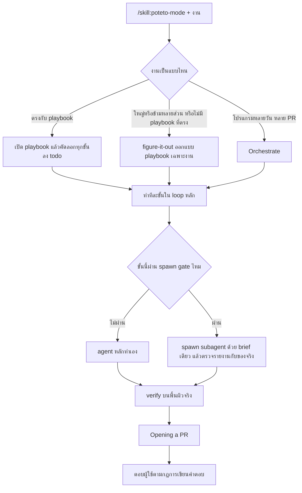
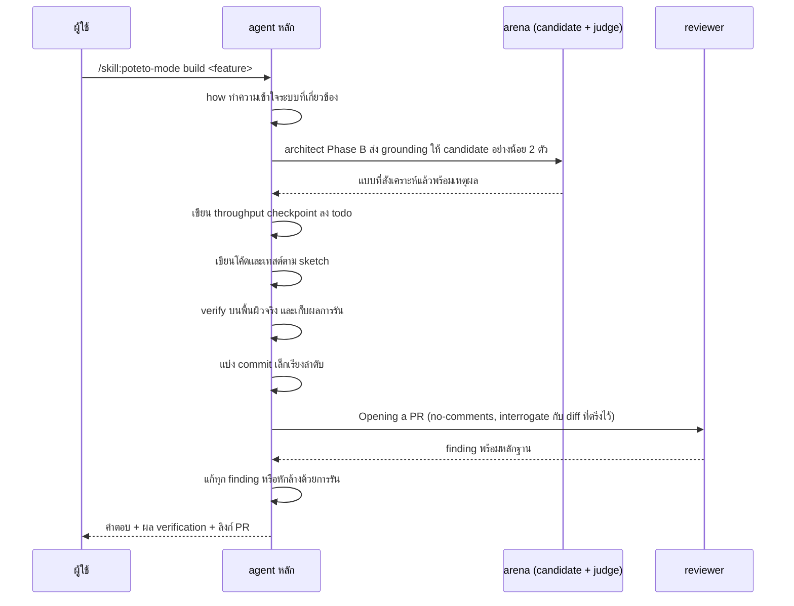

# กระบวนการทำงานทั้งหมด

เอกสารนี้อธิบายว่าเมื่อสั่งงานด้วย `/skill:poteto-mode` แล้ว เกิดอะไรขึ้นตั้งแต่ต้นจนจบ แหล่งความจริงคือ
[`skills/poteto-mode/SKILL.md`](../../skills/poteto-mode/SKILL.md) และ adapter
[`skills/pstack-omp/SKILL.md`](../../skills/pstack-omp/SKILL.md) รายละเอียดของแต่ละ playbook อยู่ที่
[`playbooks.th.md`](playbooks.th.md) และของแต่ละ skill อยู่ที่ [`skills.th.md`](skills.th.md)

## 1. ส่วนประกอบ

| ชั้น | หน้าที่ | ไฟล์ |
|---|---|---|
| Router | `poteto-mode` เลือก playbook ลำดับขั้น role และวิธี spawn เป็นตัวเดียวที่ตัดสินเรื่องเหล่านี้ | `skills/poteto-mode/SKILL.md` |
| Playbook | ขั้นตอนของงานแต่ละประเภท 23 แบบ โหลดเฉพาะแบบที่ตรงกับงาน | `skills/poteto-mode/playbooks/*.md` |
| Skill | เครื่องมือเฉพาะทางที่ playbook เรียกใช้ เช่น `how`, `why`, `architect`, `interrogate` | `skills/<name>/SKILL.md` |
| Principle | หลักคิด 24 ข้อที่ playbook อ้างถึง แต่ละข้อเป็น skill สั้นๆ | `skills/principle-*/SKILL.md` |
| Adapter | `pstack-omp` แปลงคำสั่งของ router เป็นกลไกของ OMP เช่นชื่อ agent รูปแบบ `task` และวิธีติดตามผล ไม่เลือก playbook เอง | `skills/pstack-omp/SKILL.md` |
| ตั้งค่าโมเดล | `setup-pstack` เขียนว่า role ไหนใช้โมเดลอะไร | `skills/setup-pstack/SKILL.md` |
| Agent | `poteto-agent` และ `comment-sicko` เป็น subagent ที่ plugin นี้เพิ่มให้ OMP | `agents/*.md` |

## 2. ภาพรวมตั้งแต่สั่งจนส่ง



## 3. การเลือก playbook

`poteto-mode` จับคู่งานกับ playbook จากรายการท้ายไฟล์ เช่น คำถามแบบอ่านอย่างเดียวไปที่ Investigation บั๊กที่ต้อง
reproduce ไปที่ Bug fix และพฤติกรรมใหม่ไปที่ Feature มีกฎพิเศษสองข้อ:

- งานใหญ่หรือข้ามหลายส่วน เช่น migration ข้ามหลายจุดเรียก หรืองานที่ผู้ใช้จะทิ้งไว้แล้วกลับมาตรวจ ให้ไปที่
  [`figure-it-out`](../../skills/figure-it-out/SKILL.md) แม้ Feature จะพอใช้ได้ และใช้ `figure-it-out` เมื่อไม่มี playbook
  ใดตรงเลย
- โปรแกรมระดับโปรเจกต์ที่กินหลายวัน มีหลาย PR ซ้อนกัน และมี subagent จำนวนมาก ให้ไปที่ Orchestrate
  `figure-it-out` ออกแบบการทำงานครั้งเดียว ส่วน Orchestrate ดูแลทั้งโปรแกรม

เมื่อเลือกได้แล้ว agent เปิด todo list โดยคัดลอกทุกขั้นของ playbook ลงไปตามตัวอักษรก่อนงานอื่น ขั้นที่ไม่ทำยังต้องอยู่ใน
list พร้อม `skip: <เหตุผล>` หนึ่งบรรทัด ผู้ใช้จึงเห็นว่าข้ามอะไรไปและเพราะอะไร playbook ส่วนใหญ่จบด้วย Opening a PR

## 4. Trigger ที่ใช้กับทุกงาน

นอกจาก playbook แล้ว `poteto-mode` มีเงื่อนไขที่ใช้ได้ทุกงาน:

| เมื่อ | ทำอะไร |
|---|---|
| การเปลี่ยนที่ไม่เล็ก การตัดสินใจเชิงสถาปัตยกรรม หรือคำถาม "แน่ใจไหม" | ใช้ `how` ทำความเข้าใจก่อน |
| กำลังจะถามผู้ใช้ว่าจะเลือกทางไหน | ถ้าคำตอบดูได้จากการรัน ให้ทำ prototype แล้วให้ผลตัดสิน ถามเฉพาะเรื่องรสนิยมหรือผลิตภัณฑ์ที่ทดลองไม่ได้ |
| เขียนโค้ด | ตั้งชื่อรูปข้อมูลก่อน แล้วเลือกโครงสร้างตาม `principle-model-the-domain` |
| โค้ดข้าม function boundary | ใช้ `architect` ซึ่งสำรวจแบบขนานผ่าน arena ก่อนลงมือ |
| งานขนานที่ผ่าน spawn gate | ใช้ `swarm` สำหรับ coverage, race และการสำรวจ ใช้ `arena` สำหรับประกวดแบบหรือโค้ด |
| แบบที่ยังเถียงกันอยู่ | ใช้ `interrogate` ก่อนส่ง |
| งานหลายขั้น | เขียน throughput checkpoint (Feature ขั้น 3) |
| ข้อความทุกชนิดรวมถึงคำตอบ | ใช้ `unslop` |
| เอกสาร, README, คำอธิบาย PR, commit message | ใช้ `technical-writing` |
| ก่อน commit | รัน `fable-deslop` กับ diff เมื่อมี `rpce-cli` ไม่มีให้ข้ามพร้อมหมายเหตุ |
| ก่อน review | รัน `no-comments` |
| ส่งงาน UI, IDE หรือ CLI | ควบคุมพื้นผิวจริงเอง เช่น CLI ผ่าน `bash`, เว็บผ่าน `browser` ของ `eval` |
| วัด perf หรือรายงานตัวเลขที่วัดเอง | ผ่าน `benchmark-checklist` ก่อน |
| ถามสถานะ PR | ใช้ playbook Babysit |
| ให้ land stack ที่เขียวแล้ว | ใช้ playbook Shipping เขียวไม่ได้แปลว่าปลอดภัย ทุก PR ต้องมี verdict อิสระก่อน |
| Bugbot หรือ security review คอมเมนต์ | พิจารณาทีละข้อ ปัดข้อที่ไม่จริงพร้อมเหตุผลที่ชัด |
| skill เสียกลางงาน | แก้ใน PR แยก ไม่หยุดงาน และไม่แอบเลี่ยง |
| งานยาวหรือผู้ใช้ไม่อยู่ | เก็บ decision trail ด้วย `show-me-your-work` |

## 5. Principle

principle 24 ข้อแบ่งเป็นห้ากลุ่ม คือ Core, Architecture, Verification, Delegation และ Meta ใช้ข้อไหนต้องอ่าน SKILL.md
ของข้อนั้นเต็มๆ ใน session นั้น และในคำตอบต้องบอกว่า principle ไหนเปลี่ยนการตัดสินใจอะไร อ้างได้เฉพาะข้อที่อ่านแล้วจริง
รายการทั้งหมดอยู่ใน [`skills.th.md`](skills.th.md)

## 6. ความเป็นอิสระในการตัดสินใจ

- **ทำได้เลย** งานที่ย้อนกลับได้ และการกระทำภายนอกอย่างโพสต์ในแชททีม อัปเดต ticket หรือสั่งรัน eval
- **ต้องหยุดถามเสมอ** การเขียนที่ย้อนกลับไม่ได้ ได้แก่ force-push ไป branch ที่ใช้ร่วมกัน deploy ลบข้อมูล และส่งข้อความถึงลูกค้า
- **ผู้ใช้สั่งให้ทำต่อ** เช่น "Don't stop", "going to bed", "run until done" ให้ทำต่อไปเรื่อยๆ
- **ตอบว่าไม่ได้** เมื่อถูกถามว่าควรทำไหม agent ต้องให้ความเห็นจริง ปฏิเสธหรือแย้งได้ ไม่ใช่เห็นด้วยเป็นค่าเริ่มต้น

## 7. การมอบงาน (Delegation)

### 7.1 Loop เดียวเป็นค่าเริ่มต้น

chat ที่ได้รับ `/skill:poteto-mode` ทำงานเองทั้งหมด อ่านโค้ด วางแผน เขียนโค้ดและเทสต์ verify และสรุป แผนอยู่ใน todo list
และเปลี่ยนได้ตามผลที่ได้ เพราะโมเดลที่วางแผนคือโมเดลที่ลงมือ การส่งต่องานทุกครั้งเสียทั้งความถูกต้อง เวลา และ token
(งานแบบหลาย agent มักใช้ token มากกว่า 3 ถึง 10 เท่า) subagent จึงต้องมีเหตุผลรองรับ

### 7.2 Spawn gate

spawn subagent ได้เมื่อผ่านข้อใดข้อหนึ่ง และต้องระบุข้อที่ผ่านในบรรทัด ROLE ของ brief:

1. **Context** subagent ต้องอ่านมากกว่าที่ agent หลักต้องใช้ต่อมาก เช่น transcript ยาว trace ดิบ log หรือการกวาดหลายแหล่ง
   ระดับหลายหมื่น token นับ ระดับไม่กี่พันไม่นับ ต้องลองอ่านให้แคบลงก่อน เช่น grep ช่วงบรรทัด query หรือ script ที่พิมพ์แค่คำตอบ
2. **Independence** งานต้องใช้ context ใหม่ที่ไม่เห็นของ agent หลัก เช่น review หรือ verification แบบ blackbox, panel,
   judge แบบ blind, แบบออกแบบที่แข่งกัน, candidate ของ eval หรืองานขนานที่เขียนไฟล์ไม่ทับกันแต่ละตัวใน worktree ของตัวเอง
3. **Conflict** งานต้องใช้เครื่องมือหรือคำสั่งที่ขัดกับของ agent หลักและ skill ประสานไม่ได้ เช่น audit ที่ต้องถือว่า diff
   ของเราผิดไว้ก่อน persona หรือน้ำเสียงอย่างเดียวไม่นับ

สิ่งที่ไม่ใช่เหตุผลให้ spawn ได้แก่ ชื่อ role ที่ต่างกัน (planner, implementer, tester, synthesizer), persona, skill หรือ prompt
ที่ยาว, งานหลายขั้น, ขั้นตอนตายตัว (ให้เขียน script หรือ codemod แทน) และการสรุปงานที่ agent หลักจะทำต่อเอง หลักคือแบ่งตาม
context ไม่แบ่งตามประเภทงาน ใครปูพื้นและออกแบบ คนนั้นเขียนโค้ดและเทสต์ ใครรวบรวมหลักฐาน คนนั้นเขียนข้อสรุป

### 7.3 ใครทำ role ไหน

| Role | ทำโดย | OMP agent เมื่อเป็น subagent |
|---|---|---|
| `explorer` | agent หลัก ใช้ subagent เฉพาะเมื่อผ่าน gate 1 | `scout` |
| `planner` | agent หลักเสมอ | ไม่มี |
| `designer` | agent หลัก ใช้ subagent เฉพาะเป็นที่นั่ง candidate ของ arena (gate 2) | `task` |
| `researcher` | agent หลัก ใช้ subagent หนึ่งตัวต่อแหล่งข้อมูลอิสระ (gate 1 และ 2) | `librarian` |
| `implementer` | agent หลัก ใช้ subagent เฉพาะงานขนานที่แยกขาดใน worktree ของตัวเอง (gate 2) | `poteto-agent` |
| `mechanical` | agent หลักผ่าน codemod หรือ script ใช้ subagent เฉพาะการกวาดใหญ่ที่แบ่งไฟล์ไม่ทับกัน (gate 2) | `sonic` |
| `synthesizer` | agent หลัก ยกเว้นของ `reflect` ซึ่งตัดสินบทสนทนาของ agent หลักเอง จึงเป็น subagent (gate 2) | `reviewer` สำหรับ `reflect` |
| `reviewer` | subagent เสมอ (gate 2) และไม่เคยเป็นผู้เขียนงานที่ตัวเอง review | `reviewer` |
| `owner` | subagent หนึ่งตัวต่อ PR หรือ track ใน playbook ระดับโปรแกรม (gate 2) | `poteto-agent` |
| `watcher` | `bash` job เบื้องหลังที่รันคำสั่งเฝ้า ใช้ subagent เฉพาะเมื่อต้องใช้วิจารณญาณ | `scout` |

security review ที่แยกจาก code review ใช้ `security-reviewer` ส่วนชื่อ agent ที่ใช้ได้มีเก้าตัวเท่านั้น คือ `scout`, `reviewer`,
`security-reviewer`, `librarian`, `task`, `sonic`, `poteto-agent`, `comment-sicko` และ `seance` ห้ามใส่ชื่อโมเดลลงใน `task`
เพราะการเลือกโมเดลอยู่ใน config

### 7.4 วิธีเรียก subagent ให้เหมือนเรียกเครื่องมือ

subagent ได้ brief เดียวที่มีข้อมูลครบโดยไม่ต้องรู้บทสนทนา brief ต้องมีหัวข้อเหล่านี้ก่อนส่ง:

| หัวข้อ | เนื้อหา |
|---|---|
| GOAL | ผลลัพธ์หนึ่งประโยคที่คนแปลกหน้าทำตามได้ |
| ROLE | role, ชื่อ agent, gate ที่ผ่าน, อำนาจ และท่าที |
| SCOPE | path ที่เขียนได้และไม่ได้, worktree และ branch, output path และการกำหนดผู้เขียนคนเดียว |
| CONTEXT | root ของ repo, path ที่เกี่ยวข้อง, base SHA, artifact ที่ตรึงไว้, skill และ playbook ที่ใช้, ข้อควรระวัง |
| ACCEPTANCE | ผลที่ตรวจได้ บรรทัดละข้อ |
| VERIFY | คำสั่งที่ต้องรันครบชุด รวมกรณีที่ต้องล้ม verifier ห้ามให้ผ่านเมื่อรันไม่ครบ |
| TIMEBOX | เพดานเวลา ถึงแล้วให้ส่งหลักฐานบางส่วนแล้วหยุด |
| FORBIDDEN | อย่างน้อยคือห้ามเรียก `task`, ห้าม spawn, ห้ามแก้นอกขอบเขต, ห้าม merge, ห้ามถามผู้ใช้, ห้ามอ้างว่าเสร็จโดยไม่ได้รัน verification |
| REPORT | รูปแบบเดียวกันทุกตัว (ดูด้านล่าง) |
| STANDING | นโยบายประจำของ playbook ถ้ามี |

รายงานที่ subagent ส่งกลับมีรูปแบบเดียว:

- verdict เป็น `PASS`, `ISSUES` หรือ `BLOCKED`
- ข้อสรุป
- หลักฐานเป็นตัวชี้ เช่น `file:line` หรือคำสั่งพร้อมผล
- สิ่งที่ทำไป เช่นไฟล์ที่แก้และคำสั่งที่รัน
- ข้อจำกัดและความมั่นใจ ส่วนที่ทำต่างจาก brief และความเสี่ยงที่ยังเหลือ
- branch และ SHA ถ้ามี

เมื่อเปิด `task.structured` ไว้ รูปแบบนี้ส่งเป็น `outputSchema` ได้ agent หลักต้องตรวจข้อสรุปกับของจริงก่อนนำไปพูดต่อหรือใช้ต่อ
และต้องเขียนสรุปเอง ไม่ส่งต่อคำพูดของ subagent ตรงๆ

### 7.5 รูปแบบการ spawn สี่แบบ

| แบบ | ใช้เมื่อ | ขั้นสำคัญ |
|---|---|---|
| Bounded session | งานชิ้นเดียวมีขอบเขตชัด | brief เดียว, บันทึก ID และ base SHA, แก้ได้หนึ่งครั้งภายในงานเดิม, agent หลักรัน verification ซ้ำเองก่อนรับงาน |
| Panel | หลายคนทำส่วนอิสระหรือแข่งกัน | เริ่มทุกคนใน batch เดียวก่อนอ่านผล, ตรึงผลงานก่อน, เริ่ม reviewer ใน batch ใหม่, agent หลักรวมผลและตัดสิน |
| Long-lived owner | เจ้าของ PR หรือ track ที่ต้องทำหลายช่วง | `poteto-agent` หนึ่งตัวต่องาน, ส่งงานช่วงถัดไปผ่าน `write agent://<id>`, agent หลักตรวจทุกช่วงก่อนอนุญาตต่อ |
| One-shot watcher | เฝ้า PR หรือสถานะบางอย่าง | รันคำสั่งเฝ้าเป็น `bash` job เบื้องหลัง, จด head SHA ตอนเริ่ม, ทิ้งผลถ้า SHA เปลี่ยน, หยุดด้วย `write proc://<id>/kill` |

subagent ไม่เคย spawn subagent ต่อ ถ้าต้องการงานเพิ่มให้ส่ง brief ที่เสนอกลับมาให้ agent หลัก

### 7.6 ความเป็นเจ้าของและการตรวจ

- หนึ่ง branch, worktree, state หรือ output path มีผู้เขียนคนเดียว
- ผู้เขียนไม่ review งานตัวเอง เมื่อ agent หลักต้องคัดแยก review ของ diff ที่ตัวเองเขียน ทุก finding ต้องแก้ หรือหักล้างด้วยหลักฐานที่รันได้
- รายงานของ worker ไม่นับเป็นการ verify งานของตัวเอง
- commit ใหม่ การ restack หรือการแก้ conflict ทำให้ verdict เดิมเป็นโมฆะ
- judge และ synthesizer ให้คำแนะนำ agent หลักเป็นผู้ตัดสินขั้นสุดท้าย รวมถึงการ merge การลบ และการเขียนสู่ภายนอก
- อ้างว่าโมเดลต่างกันได้เฉพาะเมื่อ OMP รายงานโมเดลที่ใช้จริงกลับมา

### 7.7 Subagent ใหม่เป็นค่าเริ่มต้น

งานต่อเนื่องจากสิ่งที่ agent หลักเขียนเองอยู่ใน loop หลัก ถ้างานอยู่กับ subagent อยู่แล้ว รอบถัดไป (แก้ ตามต่อ ลองใหม่ หรืองานถัดในคิว)
ให้ subagent ตัวใหม่พร้อม brief ที่รวมทุกอย่างแล้ว ส่งข้อความหา subagent ตัวเดิมได้เฉพาะเมื่องานใหม่ต้องใช้ state ที่ย้ายยาก
เช่น checkout ในเครื่องของมัน การแก้ที่ยังไม่ commit หรือ process ที่ยังรันอยู่

## 8. วงจรของการเปลี่ยนโค้ดหนึ่งครั้ง

ตัวอย่างนี้เป็นเส้นทางของ Feature ซึ่งเป็นแบบที่ครบที่สุด playbook อื่นใช้บางส่วน



หลังเปิด PR แล้ว Babysit ดูแลให้ PR พร้อม merge (conflict, review thread, CI) และ Shipping ตรวจ stack ที่เขียวแล้วอย่างอิสระ
ทีละ PR ก่อน land จากล่างขึ้นบน

## 9. การตั้งค่าโมเดล

OMP เลือกโมเดลตาม role ไม่ได้เลือกในแต่ละการเรียก `/skill:setup-pstack` เขียน `modelRoles` และ `task.agentModelOverrides`
ลงใน config งบด้าน reasoning ที่ตั้งตรงนั้นมีผลกับ subagent เท่านั้น session หลักใช้โมเดลจาก `/model` หรือ
`modelRoles.default` เมื่อ review หรือ judge หลายตัวใช้โมเดลตระกูลเดียวกัน ความเห็นที่ตรงกันเป็นแค่การสุ่มซ้ำ ไม่ใช่การยืนยันอิสระ
`setup-pstack` จะแจ้งเมื่อเกิดกรณีนี้

## 10. การเขียนคำตอบ

ทุก playbook จบด้วยคำตอบที่เขียนตามกฎเดียวกัน:

- ประโยคสั้น บอกเล่า หนึ่งความคิดต่อประโยค
- ไม่ใช้เครื่องหมายขีดยาว และไม่ใช้ colon เชื่อมกลางประโยค ใช้ colon ก่อนรายการได้
- สั้นแต่ไม่ตัดเนื้อหา ทุกส่วนที่ playbook กำหนดต้องอยู่ครบ
- บอกผลต่อผู้ใช้ปลายทางและต่อคนที่จะดูแลโค้ดต่อก่อนรายละเอียดการ implement
- ไม่แต่งลิงก์หรือแหล่งอ้างอิง อ้างได้เฉพาะสิ่งที่สร้างหรืออ่านใน session นั้น
- ทุกข้ออ้างต้องมีหลักฐานหรือป้ายกำกับในประโยคเดียวกัน คือ วัดแล้ว อนุมาน หรือเดา และไม่โยนงานตรวจที่ agent รันเองได้ให้ผู้ใช้
- ลิงก์ PR อยู่ในรูป `https://github.com/<owner>/<repo>/pull/<number>`

comment ในโค้ดใช้กฎเดียวกัน เก็บไว้เฉพาะเหตุผลที่โค้ดบอกเองไม่ได้

## 11. Script ที่มากับ skill

บาง playbook รัน script ที่อยู่ใน `skills/poteto-mode/scripts/` เช่น `watch-pr`, `check-plan.mjs`, `worktree-audit.sh` และ `orch`
path แบบ `skill://` อ่านได้แต่รันไม่ได้ จึงต้องหา path จริงก่อนหนึ่งครั้งต่อ session:

```bash
SKILLDIR=$(realpath skill://poteto-mode)
cd "$SKILLDIR/scripts" && bun install
```

## 12. เอกสารที่เกี่ยวข้อง

- [`playbooks.th.md`](playbooks.th.md) ขั้นตอนของทั้ง 23 playbook
- [`skills.th.md`](skills.th.md) คำอธิบายทั้ง 59 skill
- [`../pstack-guide-notes.th.md`](../pstack-guide-notes.th.md) สรุปคู่มือ pstack ของ poteto และการเทียบกับ repo นี้
- [`../single-loop/inventory.tsv`](../single-loop/inventory.tsv) จุดที่เคย spawn ทั้ง 40 จุดพร้อมคำตัดสิน
- [`../single-loop/decisions.tsv`](../single-loop/decisions.tsv) บันทึกการตัดสินใจพร้อมหลักฐาน
